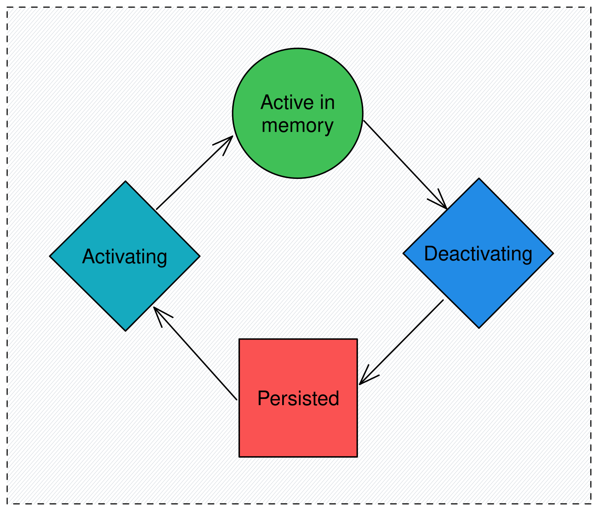
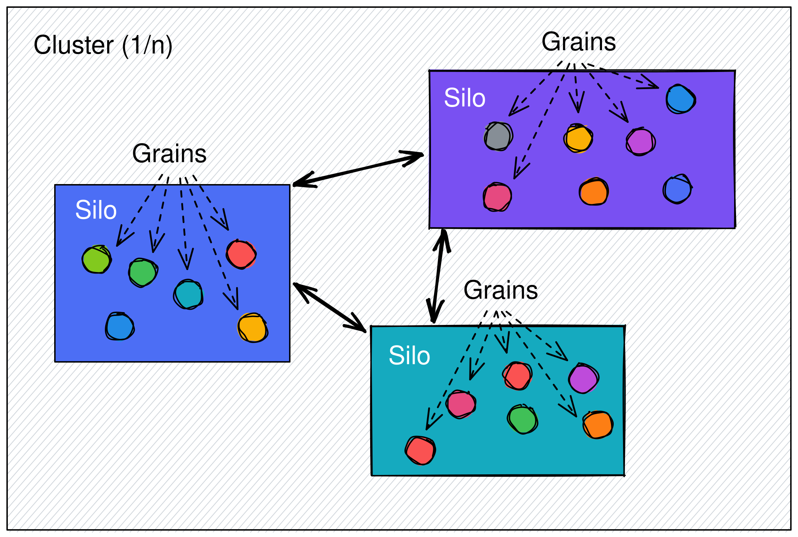
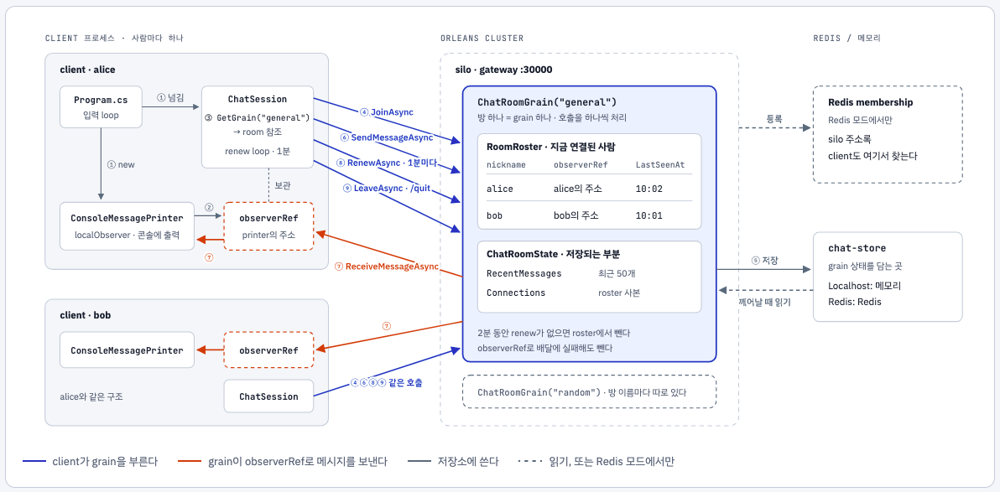
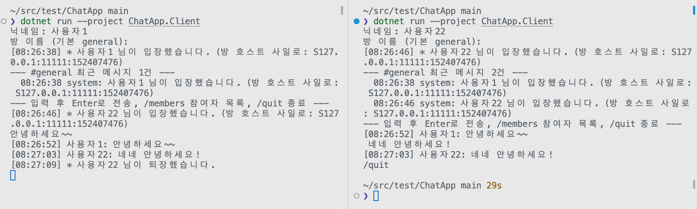
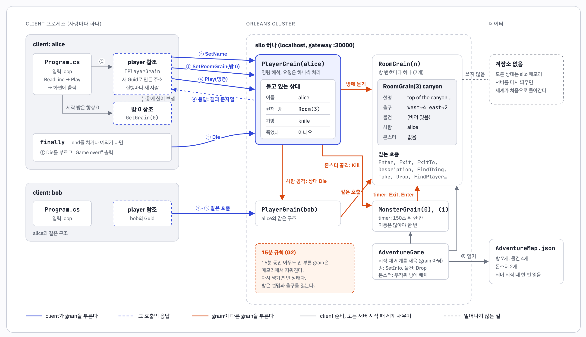

# 분산 시스템 설계(3) - 액터 모델(3): .NET Orleans

지난 글에서는 [동시성과 병렬성](https://netscout.github.io/posts/%EB%B6%84%EC%82%B0-%EC%8B%9C%EC%8A%A4%ED%85%9C-%EC%84%A4%EA%B3%84-3-%EC%95%A1%ED%84%B0-%EB%AA%A8%EB%8D%B8-1-feat-go-node-js-net-java-rust/) 그리고 [객체를 통해 액터 모델의 기원](https://netscout.github.io/posts/%EB%B6%84%EC%82%B0-%EC%8B%9C%EC%8A%A4%ED%85%9C-%EC%84%A4%EA%B3%84-3-%EC%95%A1%ED%84%B0-%EB%AA%A8%EB%8D%B8-2-%EC%83%81%ED%83%9C%EB%8A%94-%EB%88%84%EA%B0%80-%EC%96%B4%EB%96%BB%EA%B2%8C-%EA%B4%80%EB%A6%AC%ED%95%98%EB%82%98/)을 알아봤습니다.

그리고 그 결과는 다음과 같았죠.

- 액터 모델은 어떻게 하면 객체가 네트워크로 연결된 여러 프로세서에 분산되어 병렬성을 확보할지에 대한 고민으로 출발했다.
- 액터는 공유하는 상태가 없으며, 자신의 상태만 변경 가능하고 다른 액터끼리는 메시지를 통해 통신하도록 하여 동시성 문제를 해결하고자 했다.
- 그래서 액터가 네트워크의 어디에 있든지(심지어 같은 컴퓨터에 있다고 하더라도) 메시지를 통해 통신하도록 한다.
- 액터를 관리하는 런타임이 메시지를 액터의 위치로 라우트하여 위치 투명성을 보장한다. 따라서 시스템의 확장이 용이하다.
- 액터가 자신만의 상태를 가지므로, 액터에 문제가 생겨도 문제가 생긴 액터만 복구하면 된다.

이 정도면 배경은 충분히 알아봤다는 생각이 듭니다. 이제 액터 모델로 아주 간단한 무언가라도 해봐야겠죠.

이번에는 .NET Orleans를 통해서 액터 모델을 확인해볼 겁니다. 그럼 우선 Orleans에 대해서 좀 알아봐야겠죠?

## Orleans

[Orleans](https://learn.microsoft.com/en-us/dotnet/orleans/overview?pivots=orleans-10-0)는 분산 환경의 앱 개발을 단순화해 주는 액터 모델 기반의 프레임워크입니다. 공식 문서에 따르면 `분산 .NET(Distributed .NET)`이라고도 부르며 다음과 같은 내용을 지원합니다:

- 유연한 확장을 위해 디자인되었다. 서버를 추가하거나 삭제하면 Orleans가 그에 따라 확장성과 내결함성(fault tolerance)을 유지한다.
- 분산 시스템 개발이 처음인 사람도 접근할 수 있도록 분산 시스템 개발을 단순화한다.
- .NET이 지원되는 환경 어디서나 작동하며 클라우드 기반 운용에 적합하다.
- 쿠버네티스 및 Azure 같은 현대적인 배포 옵션을 지원한다.

Orleans는 2011년 Xbox 인기 게임 프랜차이즈인 헤일로의 클라우드 서비스를 시작으로 많은 Microsoft의 클라우드 서비스를 위해 사용되어 왔고, 2015년에 [오픈소스로 공개](https://github.com/dotnet/orleans)되었습니다.

### 가상 액터

Orleans 이전에 Erlang과 Akka, Akka.NET 등이 있었지만, 액터의 생명 주기를 직접 관리해야 한다든지 하는 어려움이 있었습니다. 그래서 Orleans는 추상화 레벨을 높여서 분산 시스템 전문가가 아니더라도 분산 시스템을 개발할 수 있도록 하기 위해 설계되었습니다. 그 핵심에는 가상 액터(virtual actor)가 있습니다.

- Orleans의 액터는 항상 존재하며, 명시적으로 생성하거나 제거할 수 없다. 항상 존재하기 때문에 특정 메모리 인스턴스, 특정 서버(네트워크에서 언제든 추가/삭제될 수 있으므로)의 수명을 초월(transcends)하여 존재한다.
- Orleans 액터는 자동으로 생성된다. 만약 네트워크 어디에도 특정 액터의 인스턴스가 존재하지 않는다면, 그 액터에게 메시지가 수신되는 시점에 생성 가능한 서버의 메모리에 생성되며 일정 시간 사용되지 않은 액터는 메모리 관리를 위해 제거한다.
- 액터가 생성된 서버에 문제가 생기더라도 액터에게 새로운 메시지가 도달하는 순간 Orleans가 다른 서버에 액터를 생성하여 처리하도록 한다.
- 코드는 액터의 위치를 알 필요가 없으므로 개발을 단순화할 수 있다.
- 상태 없는 액터(stateless worker)의 경우 Orleans는 자동으로 여러 개의 인스턴스를 생성하여 확장할 수 있다.

그러니까 `액터 관리는 내가 다 알아서 할 테니까, 개발자님께서는 액터한테 메시지 던지는 거나 신경 쓰세요~` 하는 거죠.

### 그레인, 사일로

가상 액터를 Orleans에서는 그레인(grain)이라고 부릅니다. 그레인은 고유한 ID, 상태와 메서드를 가지는데요, 특정한 고유값(ex: 채팅방 이름)에 대한 그레인을 호출하면 Orleans 런타임이 인스턴스를 생성해서 사일로의 메모리에 띄워주는 거죠. Orleans 런타임은 그레인을 다음과 같이 관리합니다.

<p align="center"><br />https://learn.microsoft.com/en-us/dotnet/orleans/overview?pivots=orleans-10-0</p>

그레인에게 메시지를 전달해야 할 때, Orleans 런타임은 그레인의 인스턴스를 생성합니다. 그리고 일정 시간 동안 사용되지 않은 그레인은 메모리 확보를 위해 제거됩니다. 그레인은 각자 고유한 ID를 가지므로 구별할 수 있고, 존재 유무와 상관없이 메시지를 전달할 수 있는 가상 액터라서 런타임이 자동으로 제거해도 괜찮습니다. 그레인의 상태 값이 갱신될 때 또는 그레인이 비활성화되어 제거될 때, 상태 값을 DB 등의 저장소에 저장하도록 코드를 작성 할 수 있습니다. 그러면 나중에 다시 활성화될 때 저장소에서 상태 값을 읽어서 원래대로 돌아올 수 있습니다! 그러니까 가상 액터 개념 덕분에 개발자는 그레인이 항상 메모리 어딘가에 있다고 생각하고 그냥 호출하면 됩니다.

그리고 그레인은 하나의 사일로 안에서 실행됩니다. 사일로는 하나 이상의 그레인을 관리하면서 원격 호출 작업을 조율하고 오류 복구 등의 작업을 진행합니다. 그리고 여러 사일로를 클러스터로 묶어서 확장성과 안정성을 확보할 수 있습니다.

<p align="center"><br />https://learn.microsoft.com/en-us/dotnet/orleans/overview?pivots=orleans-10-0</p>


## 간단한 예제

자 그럼 아주아주 간단한 채팅 프로젝트를 하나 만들어서 동작을 확인해보죠!

우선 dotnet을 설치해야겠죠. (이하 커맨드는 macOS 기준입니다.)

```bash
# .NET 10 SDK 설치
brew install --cask dotnet-sdk
dotnet --version        # 10.x.x 인지 확인
```

그리고 다음 명령어로 프로젝트 구성 및 참조 패키지를 추가합니다. 

```bash
mkdir ChatApp && cd ChatApp
dotnet new sln -n ChatApp

dotnet new classlib -n ChatApp.Abstractions -f net10.0
dotnet new classlib -n ChatApp.Grains       -f net10.0
dotnet new console  -n ChatApp.Silo         -f net10.0
dotnet new console  -n ChatApp.Client       -f net10.0

dotnet sln add ChatApp.Abstractions ChatApp.Grains ChatApp.Silo ChatApp.Client

# 참조 관계
dotnet add ChatApp.Grains  reference ChatApp.Abstractions
dotnet add ChatApp.Silo    reference ChatApp.Grains
dotnet add ChatApp.Client  reference ChatApp.Abstractions

# 패키지
dotnet add ChatApp.Abstractions package Microsoft.Orleans.Sdk
dotnet add ChatApp.Grains       package Microsoft.Orleans.Sdk
dotnet add ChatApp.Grains       package Microsoft.Orleans.Runtime
dotnet add ChatApp.Grains       package Microsoft.Extensions.Logging.Abstractions

dotnet add ChatApp.Silo package Microsoft.Orleans.Server
dotnet add ChatApp.Silo package Microsoft.Orleans.Clustering.Redis
dotnet add ChatApp.Silo package Microsoft.Orleans.Persistence.Redis
dotnet add ChatApp.Silo package Microsoft.Extensions.Hosting

dotnet add ChatApp.Client package Microsoft.Orleans.Client
dotnet add ChatApp.Client package Microsoft.Orleans.Clustering.Redis
dotnet add ChatApp.Client package Microsoft.Extensions.Hosting
```

완성된 프로젝트 구조는 다음과 같습니다.

```
ChatApp/
├── ChatApp.Abstractions/   # 그레인 인터페이스 + 메시지 타입 (사일로/클라이언트가 공유하는 유일한 계약)
├── ChatApp.Grains/         # 그레인 구현 (사일로에만 배포)
├── ChatApp.Silo/           # 사일로 호스트
└── ChatApp.Client/         # 콘솔 채팅 클라이언트
```

### 계약 정의(ChatApp.Abstractions)

채팅방을 관리하는 서버측 그레인과 클라이언트, 그리고 서로 주고받을 메시지의 인터페이스를 정의합니다.

`ChatRoomContracts.cs`를 다음과 같이 작성합니다.

```csharp
namespace ChatApp.Abstractions;

/// <summary>
/// 채팅 메시지, 시스템 알림(입장/퇴장)의 경우 Sender를 SystemSender로 설정한다.
/// </summary>
[GenerateSerializer, Immutable]
public sealed record ChatMessage(
    [property: Id(0)] string RoomName,
    [property: Id(1)] string Sender,
    [property: Id(2)] string Text,
    [property: Id(3)] DateTimeOffset SentAt)
{
    public const string SystemSender = "system";
    public bool IsSystemNotice => Sender == SystemSender;
}

/// <summary>
/// 채팅방 그레인(가상 액터), 그레인의 키는 방 이름이다.
/// 
/// 같은 이름으로 그레인을 참조하면, 클러스터 어디에서든 동일한 그레인을 가리킨다.
/// 메시지 순서 보장, 최근 이력 저장, 연결된 사람에게 메시지 push등은 모두 그레인 안에서 처리하므로,
/// 호출자는 그레인의 메서드를 호출하기만 하면 된다.
/// </summary>
public interface IChatRoomGrain : IGrainWithStringKey
{
    /// <summary>
    /// 방에 연결한다. 새 연결이면 입장 알림을 보내고 최근 메시지를 돌려준다.
    /// 같은 연결에 대해 다시 호출되면 별도의 알림 없이 만료 시각만 연장한다.
    /// 살아 있는 다른 연결이 같은 닉네임(대소문자 무시)을 쓰면 NicknameTaken을 true로 리턴하고, 연결은 아무것도 바뀌지 않는다.
    /// </summary>
    Task<JoinResult> JoinAsync(string nickname, IChatRoomObserver observerRef);

    /// <summary>
    /// 채팅방에 연결된 상태라면 연결의 만료 시각을 연장하고 true를 리턴한다.
    /// 이미 방에서 퇴장한 상태라면 false를 리턴한다.
    /// </summary>
    Task<bool> RenewAsync(IChatRoomObserver observerRef);

    /// <summary>
    /// 채팅방에서 퇴장하면서 퇴장 알림을 전송한다.
    /// </summary>
    Task LeaveAsync(IChatRoomObserver observerRef);

    Task SendMessageAsync(string nickname, string text);

    /// <summary>
    /// 만료된 연결을 먼저 정리한 뒤 닉네임을 정렬해서 리턴한다.
    /// </summary>
    Task<IReadOnlyList<string>> GetMembersAsync();
}

/// <summary>
/// 채팅방에서 도착하는 메세지를 받아 처리하는 클라이언트 인터페이스.
/// </summary>
public interface IChatRoomObserver : IGrainObserver
{
    Task ReceiveMessageAsync(ChatMessage message);
}

/// <summary>
/// 입장 결과. NicknameTaken이 true이면 RecentMessages는 빈 목록이다.
/// </summary>
[GenerateSerializer, Immutable]
public sealed record JoinResult(
    [property: Id(0)] bool NicknameTaken,
    [property: Id(1)] IReadOnlyList<ChatMessage> RecentMessages);

/// <summary>
/// 방과 클라이언트가 함께 지키는 시간 약속.
/// </summary>
public static class RoomConnectionTiming
{
    /// <summary>
    /// 채팅방과의 연결이 만료되는 시간
    /// </summary>
    public static readonly TimeSpan Expiry = TimeSpan.FromMinutes(2);
    /// <summary>
    /// 클라이언트가 채팅방과 연결을 갱신하는 주기.
    /// 갱신 한 번을 놓쳐도 만료되지 않도록 하기 위해 Expiry의 절반으로 설정한다.
    /// </summary>
    public static readonly TimeSpan RenewInterval = Expiry / 2;
}
```

### 채팅방 그레인 구현(ChatApp.Grains)

채팅방 하나를 나타내는 가상 액터를 그레인으로 구현합니다. 채팅방 그레인은 채팅방 참여자의 연결 정보, 최근 메시지 50개를 상태값으로 가지고 참여자가 보내는 메시지의 브로드캐스트 등을 처리합니다.

우선 채팅방의 참여자 정보를 관리하는 `RoomRoster.cs` 부터 작성해볼까요?

```csharp
using ChatApp.Abstractions;

namespace ChatApp.Grains;

/// <summary>
/// 저장되는 연결 정보. 
/// observerRef가 key이고 닉네임은 그 줄의 속성이며, LastSeenAt은 방이 이 연결을 마지막으로 확인한 시각이다.
/// </summary>
[GenerateSerializer]
public sealed record RoomConnection(
    [property: Id(0)] string Nickname,
    [property: Id(1)] IChatRoomObserver ObserverRef,
    [property: Id(2)] DateTimeOffset LastSeenAt);

/// <summary>
/// 입장 요청을 roster가 처리한 결과.
/// </summary>
public enum RosterJoinOutcome
{
    /// <summary>
    /// 채팅 방에 입장 성공.
    /// </summary>
    Added,

    /// <summary>
    /// 이미 있는 연결이다. 확인 시각만 새로 갱신하고 닉네임은 변경하지 않는다.
    /// </summary>
    Refreshed,

    /// <summary>
    /// 다른 연결이 같은 닉네임을 쓰고 있으므로 입장 거부 된다.
    /// </summary>
    NicknameTaken,
}

/// <summary>
/// 채팅방에 참여한 사람들의 연결 정보 목록.
/// 연결 객체(observerRef)와 닉네임을 한 쌍으로 기록한다.
/// 연결 비교, 닉네임 중복 규칙, 만료 판정, 메시지 전달과 전달 실패를 처리한다.
/// </summary>
public sealed class RoomRoster
{
    private readonly TimeProvider timeProvider;
    private readonly List<RoomConnection> connections;

    /// <summary>
    /// 그레인을 생성/활성화 할 때 저장소에서 읽은 연결 정보를 복구한다.
    /// </summary>
    public RoomRoster(TimeProvider timeProvider, IEnumerable<RoomConnection> restoredConnections)
    {
        this.timeProvider = timeProvider;
        connections = [.. restoredConnections];
    }

    /// <summary>
    /// 살아 있는 연결의 닉네임을 정렬해서 돌려준다.
    /// </summary>
    public IReadOnlyList<string> Nicknames
        => [.. connections.Where(IsAlive).Select(c => c.Nickname).Order()];

    /// <summary>
    /// 입장 순서로 기록된 모든 참여 정보(만료된 연결 포함)의 저장 전용 복사본이다.
    /// 저장소에 넘기고 생성자로 되살리는 것 말고는 쓰지 않는다.
    /// </summary>
    public IReadOnlyList<RoomConnection> Snapshot => [.. connections];

    /// <summary>
    /// 채팅 참여자를 채팅방에 입장시킨다.
    /// 이미 같은 observerRef가 참여 하고 있다면, 만료 확인 시각만 바꾸고 Refreshed를 리턴한다. (닉네임 인자는 무시한다).
    /// 닉네임은 같지만(대소문자 무시) 다른 observerRef가 참여 중이라면, NicknameTaken을 리턴한다.
    /// 채팅방에 참여가능하다면, 참여정보를 추가하고 Added 리턴.
    /// </summary>
    public RosterJoinOutcome Join(string nickname, IChatRoomObserver observerRef)
    {
        var now = timeProvider.GetUtcNow();

        var own = connections.FindIndex(c => c.ObserverRef.Equals(observerRef) && IsAlive(c));
        if (own >= 0)
        {
            connections[own] = connections[own] with { LastSeenAt = now };
            return RosterJoinOutcome.Refreshed;
        }

        var nicknameTaken = connections.Any(c =>
            IsAlive(c) && c.Nickname.Equals(nickname, StringComparison.OrdinalIgnoreCase));
        if (nicknameTaken)
        {
            return RosterJoinOutcome.NicknameTaken;
        }

        // 같은 observerRef로 참여했지만 만료된 참여 정보가 있다면 삭제.
        connections.RemoveAll(c => c.ObserverRef.Equals(observerRef));
        connections.Add(new RoomConnection(nickname, observerRef, now));
        return RosterJoinOutcome.Added;
    }

    /// <summary>
    /// 살아 있는 연결의 확인 시각을 지금으로 갱신하고 true를 리턴한다.
    /// </summary>
    public bool Renew(IChatRoomObserver observerRef)
    {
        var index = connections.FindIndex(c => c.ObserverRef.Equals(observerRef) && IsAlive(c));
        if (index < 0)
        {
            return false;
        }

        connections[index] = connections[index] with { LastSeenAt = timeProvider.GetUtcNow() };
        return true;
    }

    /// <summary>
    /// 채팅방에서 퇴장한다.
    /// 퇴장하는 연결 정보의 닉네임을 리턴하고, 연결 정보를 찾을 수 없는 경우 null을 리턴한다.
    /// </summary>
    public string? Leave(IChatRoomObserver observerRef)
    {
        var index = connections.FindIndex(c => c.ObserverRef.Equals(observerRef));
        if (index < 0)
        {
            return null;
        }

        var nickname = connections[index].Nickname;
        connections.RemoveAt(index);
        return nickname;
    }

    /// <summary>
    /// 만료된 연결을 모두 제거하고 그 닉네임들을 입장 순서로 리턴한다.
    /// </summary>
    public IReadOnlyList<string> RemoveExpired()
    {
        var nicknames = connections.Where(IsExpired).Select(c => c.Nickname).ToArray();
        connections.RemoveAll(IsExpired);
        return nicknames;
    }

    /// <summary>
    /// 살아 있는 연결에만 입장 순서대로 메시지를 한 명씩 전달한다.
    /// 배달 중 예외가 발생한 연결은 목록에서 빼고, 나머지는 계속 처리한다.
    /// 예외는 이 함수 밖으로 나가지 않도록 하고, 오류가 생긴 닉네임 목록을 입장 순서로 리턴한다.
    /// </summary>
    public async Task<IReadOnlyList<string>> NotifyAllAsync(ChatMessage message)
    {
        var failed = new List<RoomConnection>();
        foreach (var connection in connections.Where(IsAlive).ToArray())
        {
            try
            {
                await connection.ObserverRef.ReceiveMessageAsync(message);
            }
            catch (Exception)
            {
                failed.Add(connection);
            }
        }

        connections.RemoveAll(failed.Contains);
        return [.. failed.Select(c => c.Nickname)];
    }

    private bool IsExpired(RoomConnection connection)
        => timeProvider.GetUtcNow() - connection.LastSeenAt > RoomConnectionTiming.Expiry;

    private bool IsAlive(RoomConnection connection) => !IsExpired(connection);
}
```

그리고 채팅방 그레인 `ChatRoomGrain.cs`를 작성합니다.

```csharp
using ChatApp.Abstractions;
using Microsoft.Extensions.Logging;

namespace ChatApp.Grains;

/// <summary>
/// 저장소에 영속적으로 저장되는 부분.
/// </summary>
[GenerateSerializer]
public sealed class ChatRoomState
{
    [Id(0)] public List<ChatMessage> RecentMessages { get; set; } = [];
    /// <summary>
    /// 사일로가 다시 켜져도 연결을 되살릴 수 있도록 연결 목록을 저장한다.
    /// </summary>
    [Id(1)] public List<RoomConnection> Connections { get; set; } = [];
}

/// <summary>
/// 채팅방 그레인(가상 액터)
/// </summary>
/// <param name="persistedRoom">저장소에 영속적으로 저장되는 데이터</param>
/// <param name="logger"></param>
public sealed class ChatRoomGrain(
    // 스토리지의 실제 구현(메모리,Redis 등)은 silo의 호스트가 바인딩한다.
    [PersistentState(stateName: "room", storageName: "chat-store")]
    IPersistentState<ChatRoomState> persistedRoom,
    ILogger<ChatRoomGrain> logger) : Grain, IChatRoomGrain
{
    private const int RecentMessageLimit = 50;

    /// <summary>
    /// 채팅방 참여자 목록(닉네임, 연결 정보, 최근 활동 시각)
    /// </summary>
    private RoomRoster roster = null!;

    /// <summary>
    /// 그레인의 PK는 채팅방 이름
    /// </summary>
    private string RoomName => this.GetPrimaryKeyString();

    public override Task OnActivateAsync(CancellationToken cancellationToken)
    {
        // 사일로가 다시 켜지면 마지막으로 저장된 연결을 복구한다.
        roster = new RoomRoster(TimeProvider.System, persistedRoom.State.Connections);

        return Task.CompletedTask;
    }

    public async Task<JoinResult> JoinAsync(string nickname, IChatRoomObserver observerRef)
    {
        await RemoveExpiredConnectionsAsync();

        switch (roster.Join(nickname, observerRef))
        {
            case RosterJoinOutcome.NicknameTaken:
                return new JoinResult(true, []);

            case RosterJoinOutcome.Refreshed:
                await SaveAsync();
                break;

            case RosterJoinOutcome.Added:
                // 어느 사일로가 이 방을 호스팅하는지 보여주면 분산 동작을 눈으로 확인하기 좋다.
                await BroadcastAsync(ChatMessage.SystemSender,
                    $"{nickname} 님이 입장했습니다. (방 호스트 사일로: {RuntimeIdentity})");
                break;
        }

        return new JoinResult(false, persistedRoom.State.RecentMessages.ToArray());
    }

    /// <summary>
    /// 채팅방과의 연결이 만료되지 않도록 갱신
    /// </summary>
    /// <param name="observerRef">클라이언트의 옵저버 객체</param>
    /// <returns></returns>
    public async Task<bool> RenewAsync(IChatRoomObserver observerRef)
    {
        await RemoveExpiredConnectionsAsync();

        if (!roster.Renew(observerRef))
        {
            return false;
        }

        await SaveAsync();
        return true;
    }

    public async Task LeaveAsync(IChatRoomObserver observerRef)
    {
        await RemoveExpiredConnectionsAsync();

        if (roster.Leave(observerRef) is { } nickname)
        {
            await BroadcastAsync(ChatMessage.SystemSender, $"{nickname} 님이 퇴장했습니다.");
        }
    }

    public async Task SendMessageAsync(string nickname, string text)
    {
        await RemoveExpiredConnectionsAsync();

        if (string.IsNullOrWhiteSpace(text)) {
            return;
        }
        await BroadcastAsync(nickname, text.Trim());
    }

    public async Task<IReadOnlyList<string>> GetMembersAsync()
    {
        await RemoveExpiredConnectionsAsync();

        return roster.Nicknames;
    }

    /// <summary>
    /// 갱신 없이 만료된 연결을 목록에서 빼고, 빠진 사람마다 퇴장 알림을 보낸다.
    /// </summary>
    private async Task RemoveExpiredConnectionsAsync()
    {
        foreach (var nickname in roster.RemoveExpired())
        {
            await BroadcastAsync(ChatMessage.SystemSender, $"{nickname} 님이 응답이 없어 퇴장 처리되었습니다.");
        }
    }

    /// <summary>
    /// 현재 연결 정보 목록을 저장소에 기록한다.
    /// </summary>
    private Task SaveAsync()
    {
        persistedRoom.State.Connections = [.. roster.Snapshot];
        return persistedRoom.WriteStateAsync();
    }

    /// <summary>
    /// 전송할 메세지를 채팅 기록에 저장하고, 연결이 살아있는 모든 클라이언트(메세지 전송자 포함)에게 전송한다.
    /// </summary>
    /// <param name="sender"></param>
    /// <param name="text"></param>
    /// <returns></returns>
    private async Task BroadcastAsync(string sender, string text)
    {
        var message = new ChatMessage(RoomName, sender, text, DateTimeOffset.UtcNow);

        var history = persistedRoom.State.RecentMessages;
        history.Add(message);
        if (history.Count > RecentMessageLimit)
        {
            history.RemoveRange(0, history.Count - RecentMessageLimit);
        }
        await SaveAsync();

        var failedNicknames = await roster.NotifyAllAsync(message);
        if (failedNicknames.Count > 0)
        {
            // 배달에 실패한 연결은 roster가 이미 뺐다. 퇴장 알림은 보내지 않고 다시 저장만 한다.
            logger.LogWarning("메시지 배달에 실패해 연결을 뺐습니다: {Nicknames}", string.Join(", ", failedNicknames));
            await SaveAsync();
        }
    }
}
```

### 사일로 호스트(ChatApp.Silo)

다음으로 사일로를 호스팅하는 앱을 작성합니다. 그레인은 사일로 안에서 동작할 수 있기 때문이죠.

우선 `appsettings.json`에 설정을 다음과 같이 작성합니다. 여러 개의 사일로를 띄우려면 Redis를 설정하고 연결해야 합니다.

```json
{
  "ChatCluster": {
    "Clustering": "Localhost",
    "Redis": "localhost:6379",
    "SiloPort": 11111,
    "GatewayPort": 30000
  },
  "Logging": {
    "LogLevel": { "Default": "Information", "Orleans": "Warning" }
  }
}
```

그리고 호스트 앱 `Program.cs`를 작성합니다.

```csharp
using Microsoft.Extensions.Hosting;
using Orleans.Configuration;
using StackExchange.Redis;

// appsettings.json은 빌드할 때 bin으로 복사된다. 실행 위치와 상관없이 그 파일을 읽도록 실행 파일 폴더를 content root로 지정한다.
var builder = Host.CreateApplicationBuilder(new HostApplicationBuilderSettings
{
    Args = args,
    ContentRootPath = AppContext.BaseDirectory,
});
var settings = builder.Configuration.GetSection("ChatCluster");

var clusteringMode = settings["Clustering"] ?? "Localhost";
var redisEndpoint  = settings["Redis"] ?? "localhost:6379";
var siloPort       = int.Parse(settings["SiloPort"] ?? "11111");
var gatewayPort    = int.Parse(settings["GatewayPort"] ?? "30000");

builder.UseOrleans(silo =>
{
    // ClusterId/ServiceId가 같은 사일로끼리만 한 클러스터로 묶을 수 있으며, 클라이언트도 같은 값을 써야 합니다.
    silo.Configure<ClusterOptions>(options =>
    {
        options.ClusterId = "chat-cluster";
        options.ServiceId = "chat-app";
    });

    switch (clusteringMode)
    {
        case "Localhost":
            // 단일 프로세스 개발용. 외부 의존성 없음.
            silo.UseLocalhostClustering(siloPort: siloPort, gatewayPort: gatewayPort);
            silo.AddMemoryGrainStorage("chat-store");
            break;

        case "Redis":
            // 사일로들이 Redis 멤버십 테이블을 통해 서로를 발견합니다. 몇 개를 띄우든 상관없습니다.
            var redis = ConfigurationOptions.Parse(redisEndpoint);
            silo.UseRedisClustering(options => options.ConfigurationOptions = redis);
            silo.AddRedisGrainStorage("chat-store", options => options.ConfigurationOptions = redis);
            // 한 머신에서 여러 사일로를 띄우려면 포트만 다르게 설정하면 됩니다.
            silo.ConfigureEndpoints(siloPort, gatewayPort);
            break;

        default:
            throw new InvalidOperationException($"알 수 없는 ChatCluster:Clustering 값: {clusteringMode}");
    }
});

await builder.Build().RunAsync();
```

> Orleans는 일정 시간 동안 사용되지 않은 그레인을 메모리에서 삭제합니다. 기본값은 15분인데, 사일로 설정에서 다음과 같이 변경 가능합니다.
> ```csharp
>.UseOrleans(siloBuilder => siloBuilder
>    .UseLocalhostClustering()
>    .Configure<GrainCollectionOptions>(o =>
>    {
>        o.CollectionAge = TimeSpan.FromHours(2);   // 2 시간으로 설정
>    }))
>```

> 또는 특정 그레인의 생존 시간만 늘리고 싶으면 그레인 클래스에 속성을 붙이면 됩니다.
> ```csharp
> [CollectionAgeLimit(Hours = 2)] // 이 그레인만 2시간으로 설정
> public class PlayerGrain : Grain, IPlayerGrain { ... }
> ```

### 콘솔 클라이언트(ChatApp.Client)

이제 마지막입니다! 채팅방에 접속하여 메시지를 전송하고, 전달받은 메시지를 출력할 클라이언트를 작성해야 합니다.

우선 채팅방 그레인에 전달할 클라이언트 객체를 `ConsoleMessagePrinter.cs`에 정의합니다.

```csharp
using ChatApp.Abstractions;

namespace ChatApp.Client;

/// <summary>
/// 그레인이 전송한 메시지를 터미널에 출력한다.
/// 예외를 던지면 연결이 끊어지므로, 밖으로 던지지 않는다.
/// </summary>
public sealed class ConsoleMessagePrinter : IChatRoomObserver
{
    public Task ReceiveMessageAsync(ChatMessage message)
    {
        var time = message.SentAt.ToLocalTime().ToString("HH:mm:ss");
        Console.WriteLine(message.IsSystemNotice
            ? $"\u001b[90m[{time}] * {message.Text}\u001b[0m"
            : $"[{time}] {message.Sender}: {message.Text}");
        return Task.CompletedTask;
    }
}
```

아주 단순하게 IChatRoomObserver만 구현하여 전달받은 메시지를 콘솔에 출력하기만 합니다.

다음으로 클라이언트가 채팅방에 참여하는 세션을 `ChatSession.cs`로 구현합니다.

```csharp
using ChatApp.Abstractions;
using Microsoft.Extensions.Logging;

namespace ChatApp.Client;

/// <summary>
/// 한 사용자의 채팅방 참여 세션.
///
/// 호출자는 <see cref="JoinAsync"/>로 참여하고, <see cref="SendAsync"/>로 메세지를 보내고, dispose하면 된다.
/// 갱신이 실패해도 log로 보일 뿐 loop는 멈추지 않고, 종료할 때는 항상 퇴장을 시도한다.
/// </summary>
public sealed class ChatSession : IAsyncDisposable
{
    /// <summary>
    /// 채팅방 그레인(가상 액터)
    /// 최초 호출시 런타임에서 생성 또는 활성화 한다.
    /// </summary>
    private readonly IChatRoomGrain room;
    /// <summary>
    /// 받은 메세지를 출력하는 observer를 grain이 사용할 수 있도록 하는 객체 참조.
    /// </summary>
    private readonly IChatRoomObserver observerRef;
    /// <summary>
    /// observerRef가 가리키는 실제 객체.
    /// Orleans는 이 객체를 weak reference로 참조하므로, 직접 참조하게 해서 GC가 제거하지 않도록 한다.
    /// </summary>
    private readonly IChatRoomObserver localObserver;
    /// <summary>
    /// 종료할 때 observerRef를 해제하는 데 쓴다.
    /// </summary>
    private readonly IGrainFactory grainFactory;
    private readonly string nickname;
    private readonly ILogger logger;
    private readonly CancellationTokenSource renewCancellation = new();
    private readonly Task renewLoop;

    /// <summary>
    /// 방에 참여한다.
    /// 참여 성공시 채팅에 참여한 세션과 가장 최근까지의 채팅 기록을 리턴한다.
    /// 같은 닉네임이 이미 쓰이고 있으면 <see cref="NicknameTakenException"/>을 던진다.
    /// </summary>
    public static async Task<(ChatSession Session, IReadOnlyList<ChatMessage> RecentMessages)> JoinAsync(
        IGrainFactory grainFactory, string roomName, string nickname, IChatRoomObserver localObserver, ILogger logger)
    {
        // 그레인에서 사용할 수 있도록 observer의 객체 참조 생성.
        var observerRef = grainFactory.CreateObjectReference<IChatRoomObserver>(localObserver);
        // 채팅방 그레인 참조 생성
        var room = grainFactory.GetGrain<IChatRoomGrain>(roomName);
        var result = await room.JoinAsync(nickname, observerRef);
        if (result.NicknameTaken)
        {
            throw new NicknameTakenException(nickname, roomName);
        }

        return (new ChatSession(grainFactory, room, localObserver, observerRef, nickname, logger), result.RecentMessages);
    }

    private ChatSession(
        IGrainFactory grainFactory, IChatRoomGrain room,
        IChatRoomObserver localObserver, IChatRoomObserver observerRef,
        string nickname, ILogger logger)
    {
        this.grainFactory = grainFactory;
        this.room = room;
        this.localObserver = localObserver;
        this.observerRef = observerRef;
        this.nickname = nickname;
        this.logger = logger;
        renewLoop = RenewConnectionPeriodicallyAsync(renewCancellation.Token);
    }

    public Task SendAsync(string text) => room.SendMessageAsync(nickname, text);

    public Task<IReadOnlyList<string>> GetMembersAsync() => room.GetMembersAsync();

    public async ValueTask DisposeAsync()
    {
        await renewCancellation.CancelAsync();
        try
        {
            await renewLoop;
        }
        catch (OperationCanceledException) { }
        finally
        {
            await LeaveRoomAsync();
            renewCancellation.Dispose();
            grainFactory.DeleteObjectReference<IChatRoomObserver>(observerRef);
            // localObserver에서 생성한 observerRef(weak reference)가 해제되기 전까지는 원본 객체가 남아있어야 한다.
            GC.KeepAlive(localObserver);
        }
    }

    /// <summary>
    /// 채팅방과의 연결이 만료되어 끊어지지 않도록, 주기적으로 갱신 처리
    /// </summary>
    /// <param name="cancellation"></param>
    /// <returns></returns>
    private async Task RenewConnectionPeriodicallyAsync(CancellationToken cancellation)
    {
        using var timer = new PeriodicTimer(RoomConnectionTiming.RenewInterval);
        // WaitForNextTickAsync는 try 밖에 둔다. 그래야 취소가 loop를 끝낸다.
        while (await timer.WaitForNextTickAsync(cancellation))
        {
            try
            {
                await RenewOrRejoinAsync();
            }
            catch (Exception exception)
            {
                // 이번 갱신이 실패해도 멈추지 않는다. 다음 tick에 다시 시도한다.
                logger.LogWarning(exception, "방 연결 갱신에 실패했습니다. 다음 주기에 다시 시도합니다.");
            }
        }
    }

    /// <summary>
    /// 채팅방과의 연결 만료 시간 갱신 처리 / 이미 만료된 연결이라면 다시 참가.
    /// </summary>
    private async Task RenewOrRejoinAsync()
    {
        if (await room.RenewAsync(observerRef))
        {
            return;
        }

        var result = await room.JoinAsync(nickname, observerRef);
        if (result.NicknameTaken)
        {
            logger.LogWarning("방이 연결을 잃어 다시 입장하려 했지만 닉네임 '{Nickname}'을(를) 다른 사람이 쓰고 있습니다. 다음 주기에 다시 시도합니다.", nickname);
        }
    }

    /// <summary>
    /// 채팅방에서 퇴장한다.
    /// 호출이 실패하더라도, 만료 시간이 되면 채팅방에서 제거되므로 예외를 이 함수 밖으로 던지지 않는다.
    /// </summary>
    private async Task LeaveRoomAsync()
    {
        try
        {
            await room.LeaveAsync(observerRef);
        }
        catch (Exception exception)
        {
            logger.LogWarning(exception, "방 퇴장 요청에 실패했습니다. 방이 곧 이 연결을 만료시킵니다.");
        }
    }
}

/// <summary>같은 닉네임이 방에서 이미 쓰이고 있어 입장하지 못했음을 알린다. client 안에서만 쓴다.</summary>
public sealed class NicknameTakenException(string nickname, string roomName)
    : Exception($"닉네임 '{nickname}'은(는) #{roomName}에서 이미 쓰고 있습니다.")
{
}
```

클라이언트의 메시지 수신 객체(localObserver)를 그레인이 참조할 수 있는 형태로 변환해서(observerRef) 전달하는 부분을 잘 기억해주세요. 그리고 다시 채팅방 그레인 쪽 코드를 보시면, IChatRoomObserver 타입의 observerRef를 받아서 연결 정보를 저장하고 있습니다!

> Orleans는 그레인이 참조할 수 있는 주소를 생성할 때 원본 객체애 대해서 약한 참조(weak reference)를 생성합니다. 그런데 만약 localObserver에 대한 다른 참조가 없다면 GC가 이 객체를 회수해버릴 수도 있습니다. 그래서 ChatSession 객체가 localObserver를 내부 변수로 저장하여 참조를 유지하도록 합니다.

다음으로 Orleans 클러스터에 접속하기 위한 설정을 `ChatClusterConfiguration.cs`에 작성합니다.

```csharp
using Microsoft.Extensions.Configuration;
using Microsoft.Extensions.Hosting;
using Orleans.Configuration;
using StackExchange.Redis;

namespace ChatApp.Client;

/// <summary>설정 섹션 "ChatCluster"를 읽어 클러스터 접속 방식을 결정합니다. 사일로 쪽 Program.cs와 대칭입니다.</summary>
public static class ChatClusterConfiguration
{
    public static IClientBuilder ConnectToChatCluster(this IClientBuilder client, IConfiguration configuration)
    {
        var settings = configuration.GetSection("ChatCluster");

        client.Configure<ClusterOptions>(options =>
        {
            options.ClusterId = "chat-cluster";
            options.ServiceId = "chat-app";
        });

        return (settings["Clustering"] ?? "Localhost") switch
        {
            "Localhost" => client.UseLocalhostClustering(
                gatewayPort: int.Parse(settings["GatewayPort"] ?? "30000")),
            "Redis" => client.UseRedisClustering(options =>
                options.ConfigurationOptions = ConfigurationOptions.Parse(settings["Redis"] ?? "localhost:6379")),
            var unknown => throw new InvalidOperationException($"알 수 없는 ChatCluster:Clustering 값: {unknown}"),
        };
    }
}
```

이제 진짜 마지막입니다. 클라이언트 콘솔 앱을 `Program.cs`에 작성합니다.

```csharp
using ChatApp.Abstractions;
using ChatApp.Client;
using Microsoft.Extensions.DependencyInjection;
using Microsoft.Extensions.Hosting;
using Microsoft.Extensions.Logging;

var host = BuildHost(args);
await host.StartAsync();

var (nickname, roomName) = PromptForIdentity();
var grainFactory = host.Services.GetRequiredService<IGrainFactory>();
var sessionLogger = host.Services.GetRequiredService<ILogger<ChatSession>>();

ChatSession session;
IReadOnlyList<ChatMessage> recentMessages;
try
{
    (session, recentMessages) = await ChatSession.JoinAsync(grainFactory, roomName, nickname, new ConsoleMessagePrinter(), sessionLogger);
}
catch (NicknameTakenException exception)
{
    Console.WriteLine(exception.Message);
    Console.WriteLine("다른 닉네임으로 다시 실행하세요.");
    await host.StopAsync();
    return;
}

try
{
    PrintRecentMessages(roomName, recentMessages);
    await RunCommandLoopAsync(session);
}
finally
{
    await session.DisposeAsync();
}

await host.StopAsync();

static IHost BuildHost(string[] args)
{
    // appsettings.json은 빌드할 때 bin으로 복사된다. 실행 위치와 상관없이 그 파일을 읽도록 실행 파일 폴더를 content root로 지정한다.
    var builder = Host.CreateApplicationBuilder(new HostApplicationBuilderSettings
    {
        Args = args,
        ContentRootPath = AppContext.BaseDirectory,
    });
    builder.Logging.SetMinimumLevel(LogLevel.Warning);
    builder.UseOrleansClient(client => client.ConnectToChatCluster(builder.Configuration));
    return builder.Build();
}

static (string Nickname, string RoomName) PromptForIdentity()
{
    Console.Write("닉네임: ");
    var nickname = Console.ReadLine()!.Trim();
    Console.Write("방 이름 (기본 general): ");
    var roomName = Console.ReadLine() is { Length: > 0 } typed ? typed.Trim() : "general";
    return (nickname, roomName);
}

static void PrintRecentMessages(string roomName, IReadOnlyList<ChatMessage> recentMessages)
{
    Console.WriteLine($"--- #{roomName} 최근 메시지 {recentMessages.Count}건 ---");
    foreach (var message in recentMessages)
    {
        Console.WriteLine($"  {message.SentAt.ToLocalTime():HH:mm:ss} {message.Sender}: {message.Text}");
    }
    Console.WriteLine("--- 입력 후 Enter로 전송, /members 참여자 목록, /quit 종료 ---");
}

static async Task RunCommandLoopAsync(ChatSession session)
{
    while (Console.ReadLine() is { } line)
    {
        switch (line)
        {
            case "/quit":
                return;
            case "/members":
                Console.WriteLine("참여자: " + string.Join(", ", await session.GetMembersAsync()));
                break;
            default:
                await session.SendAsync(line);
                break;
        }
    }
}
```

## 채팅 앱의 구조

자 그러면 전체 채팅 앱의 구조를 전반적으로 살펴볼까요?

<p align="center"></p>

1. 클라이언트 앱에서 클라이언트 메시지 수신 객체 localObserver를 생성해서 ChatSession.JoinAsync로 넘겨줍니다.
2. localObserver의 주소를 그레인이 참조할 수 있도록 observerRef를 생성합니다.
3. 채팅방의 이름으로 그레인 참조를 가져옵니다. 최초 입장의 경우 아직 그레인은 생성되지 않은 상태입니다.
4. 채팅방에 참여합니다. 이때 런타임이 채팅방 그레인을 생성합니다.
5. 참여자 연결 정보, 채팅 기록을 chat-store에 기록합니다. 나중에 채팅방 그레인이 삭제 후 다시 활성화될 때 저장된 정보를 읽어서 상태를 복구합니다.
6. 참여자의 메시지를 채팅방에 전송합니다.
7. 그레인은 메시지를 채팅 기록에 저장하고, 아직 살아 있는 연결 모두에게 메시지를 전송합니다.
8. 1분마다 주기적으로 연결을 갱신합니다.
9. /quit 입력 시 채팅방에서 퇴장합니다.

## 직접 실행해보자

이제 직접 실행해 볼 차례입니다. 우선 서버 앱을 실행해서 사일로를 가동시킵니다.

```bash
# Redis로 사일로를 클러스터링하는 경우(사일로 포트를 다르게 설정해야 함)
# dotnet run --project ChatApp.Silo -- \
#  --ChatCluster:Clustering=Redis --ChatCluster:SiloPort=11111 --ChatCluster:GatewayPort=30000

# 단일 프로세스 모드로 실행
> dotnet run --project ChatApp.Silo
...
info: Microsoft.Hosting.Lifetime[0]
      Content root path: /Users/onlifecoding/src/test/ChatApp
```

그리고 터미널을 두 개 더 열어서 클라이언트 두 개를 실행합니다.

```bash
# Redis로 클러스터링된 사일로에 접속하는 경우
# dotnet run --project ChatApp.Client -- --ChatCluster:Clustering=Redis

# 단일 프로세스 모드로 실행
> dotnet run --project ChatApp.Client
```

두 클라이언트가 모두 채팅방에 참여하면 다음과 같이 채팅을 진행할 수 있습니다.

<p align="center"></p>

## 한 가지 의문

그런데 저는 코드를 작성하고 확인하면서 한 가지 의문이 머릿속을 떠나지 않았습니다.

`사일로는 도대체 그레인의 정보를 어떻게 아는 거지???`

사일로 호스트 앱의 코드에는 그레인에 대한 그 어떤 정보도 없습니다!

그 이유를 찾아보니, `원래는 개발자가 직접 그레인 타입을 지정해줘야 하지만, 7.0 버전부터는 자동으로 코드가 생성되도록 변경됐다` 였습니다. 그러니까 원래는 이렇게

```csharp
// 출처: https://sergeybykov.github.io/orleans/Documentation/clusters_and_clients/configuration_guide/server_configuration.html
var silo = new SiloHostBuilder()
    // Clustering information
    .Configure<ClusterOptions>(options =>
    {
        options.ClusterId = "my-first-cluster";
        options.ServiceId = "MyAwesomeOrleansService";
    })
    // Clustering provider
    .UseAzureStorageClustering(options => options.ConnectionString = connectionString)
    // Endpoints
    .ConfigureEndpoints(siloPort: 11111, gatewayPort: 30000)
    // Application parts: just reference one of the grain implementations that we use
    .ConfigureApplicationParts(parts => parts.AddApplicationPart(typeof(ValueGrain).Assembly).WithReferences())
    // Now create the silo!
    .Build();
```

`ConfigureApplicationParts`를 통해 그레인 타입을 지정해줘야 하지만 [7.0 버전부터는 이렇게 바뀐 거죠](https://learn.microsoft.com/en-us/dotnet/orleans/migration-guide?pivots=orleans-7-0).

> Remove calls to ConfigureApplicationParts. Application Parts have been removed. The C# Source Generator for Orleans is added to all packages (including the client and server) and automatically generates the equivalent of Application Parts.

`Microsoft.Orleans.Sdk`를 참조하는 모든 프로젝트에서 빌드할 때 `GenerateSerializer` 속성이 붙은 항목에 대해 자동으로 코드를 생성하고 `IGrain` 계열의 인터페이스(ex: `IChatRoomGrain`), `Grain` 클래스(ex: `ChatRoomGrain`) 등에 대해서 메타데이터 및 프록시 코드를 생성합니다. 그 결과 사일로 호스트는 자신이 참조하는 어셈블리에서 사용 가능한 그레인의 목록을 확인해서 등록하게 되는 거죠. 너무 자동화해 놔도 찾기가 어렵네요 하하하하...

## 예제 좀 더 살펴보기

액터 모델은 게임 서버를 구현하는 데 사용될 수도 있습니다. 맵에 배치된 각 장소, 플레이어, 몬스터 등은 각자 자신의 고유한 상태를 가지고 있으며 서버에서 각 개체는 유일하게 구별될 수 있어야 하죠. 

Orleans의 github 리포를 살펴보면 여러 가지 샘플이 같이 제공되는데, [고전 텍스트 어드벤처 게임을 서버-클라이언트 구조로 구현해 둔 샘플이 있습니다.](https://github.com/dotnet/orleans/tree/main/samples/Adventure) 매우 간단한 예제이긴 하지만 게임 서버가 어떻게 구현되는지 느낌은 가져갈 수 있겠죠. 게임의 구조를 살펴보면 다음과 같습니다.

```
Adventure/
├── AdventureClient/   # 게임 클라이언트
├── AdventureGrainInterfaces/         # 그레인 인터페이스 + 메시지 타입 (사일로/클라이언트가 공유하는 유일한 계약)
├── AdventureGrains/           # 그레인 구현 (사일로에만 배포)
└── AdventureServer/         # 게임 서버
```

> 참고로 이 샘플에는 아주아주아주 버그가 많습니다. 심지어 그레인의 상태를 관리하는 부분이 구현되어 있지 않아서 그레인이 메모리에서 제거되고 다시 활성화되면 모든 상태가 초기화되기도 합니다! 그러니까 이런 구조니까 게임 서버를 구현하기에 적합하구나 하는 정도만 이해하면 될 거 같네요!

서버와 클라이언트를 띄우고 게임을 진행해보면 대략 이런 느낌입니다.

```
 ______      __                         __
/\  _  \    /\ \                       /\ \__
\ \ \L\ \   \_\ \  __  __     __    ___\ \ ,_\  __  __  _ __    __
 \ \  __ \  /'_` \/\ \/\ \  /'__`\/' _ `\ \ \/ /\ \/\ \/\`'__\/'__`\
  \ \ \/\ \/\ \L\ \ \ \_/ |/\  __//\ \/\ \ \ \_\ \ \_\ \ \ \//\  __/
   \ \_\ \_\ \___,_\ \___/ \ \____\ \_\ \_\ \__\\ \____/\ \_\\ \____\
    \/_/\/_/\/__,_ /\/__/   \/____/\/_/\/_/\/__/ \/___/  \/_/ \/____/

What's your name?
OnlifeCoding
You are standing in an open field west of a white house with a boarded front door.
There is a forest to the north.

go north
This is a dimly lit forest, with large trees all around.
There is a clearing to the north, and a house to the south.

...

look
You are on a small beach on the Frigid River, past the falls.
There is a faint smell of sulfur coming from the ground.
There is a clearing to the north, and a canyon to the east.
Beware! These guys are in the room with you:
  An Angry Customer
  The Wicked Witch of the East

kill customer
customer is now dead.

kill witch
witch is now dead.

....

go forward

Welcome to Hades!

We must inform you that no one ever leaves.
You might as well end right now.
You are holding the following items:
brass key
knife
sandwich
glass of water

end

Game over!
```

텍스트로만 진행되다 보니 지금 보면 상당히 낯선 형태인데, 이게 여러 클라이언트가 참여해서 멀티플레이도 가능하도록 되어 있습니다. 같은 장소에 있는 플레이어를 먼저 발견하면 죽일 수도 있죠!

게임의 전체 구조를 살펴보면 다음과 같습니다.

<p align="center"></p>

0. AdventureGame 클래스가 게임을 시작하면서 세계를 구성합니다.
1. 클라이언트가 실행되며, 플레이어의 그레인 참조를 획득합니다.
2. 플레이어의 초기 상태(이름)를 설정합니다.
3. 플레이어의 초기 상태(시작하는 방의 위치)를 설정합니다.
4. 플레이어의 명령에 따라 다른 그레인과의 상호작용을 처리하고 응답을 리턴합니다.
5. 게임이 종료되면 플레이어 그레인을 죽음으로 처리하고 종료합니다. 이때 가방의 모든 물건은 방에 내려놓아 다른 플레이어가 볼 수 있게 합니다.

## 정리

처음에 액터 모델에 대해서 글을 써보자 했을 때, 이렇게 길어질 거라고는 생각을 못했습니다. 그렇게 대단한 내용이 없는데요, 개인적으로 궁금한 내용을 찾아서 정리하다 보니 생각보다 좀 더 복잡해졌네요. 그런데 여기서 끝이 아닙니다. 한 가지 더 알아보고 싶은 게 있어서 하나 더 정리해 볼 겁니다. 뭐 그냥 궁금하니까요...

## 참고 자료

- [Microsoft Orleans Overview](https://learn.microsoft.com/en-us/dotnet/orleans/overview?pivots=orleans-10-0)
- [Orleans – Virtual Actors](https://www.microsoft.com/en-us/research/project/orleans-virtual-actors/)
- [Orleans: Distributed Virtual Actors for Programmability and Scalability](https://www.microsoft.com/en-us/research/publication/orleans-distributed-virtual-actors-for-programmability-and-scalability/)
- [Grain persistence](https://learn.microsoft.com/en-us/dotnet/orleans/grains/grain-persistence/)
- [Observers](https://learn.microsoft.com/en-us/dotnet/orleans/grains/observers)
- [Activation collection](https://learn.microsoft.com/en-us/dotnet/orleans/host/configuration-guide/activation-collection)
- [Serialization](https://learn.microsoft.com/en-us/dotnet/orleans/host/configuration-guide/serialization)
- [Stateless worker grains](https://learn.microsoft.com/en-us/dotnet/orleans/grains/stateless-worker-grains)
- [Migrate from Orleans 3.x to 7.0](https://learn.microsoft.com/en-us/dotnet/orleans/migration-guide?pivots=orleans-7-0)
- [dotnet/orleans (GitHub)](https://github.com/dotnet/orleans)
- [Orleans 샘플: Adventure](https://github.com/dotnet/orleans/tree/main/samples/Adventure)