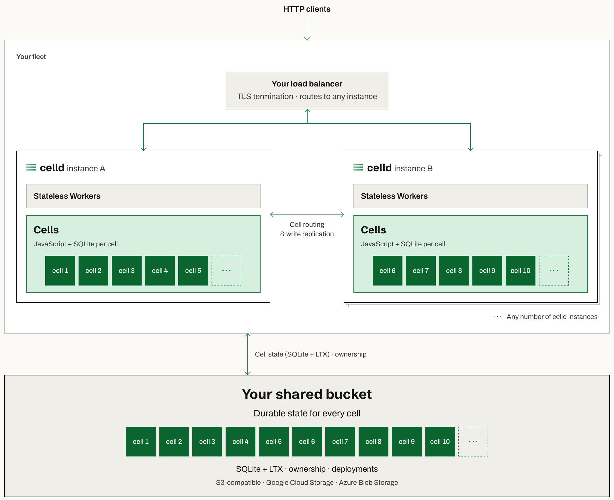
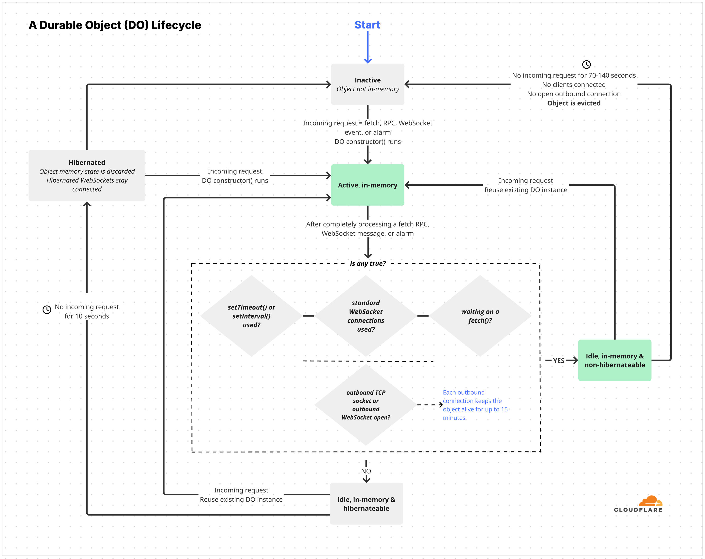
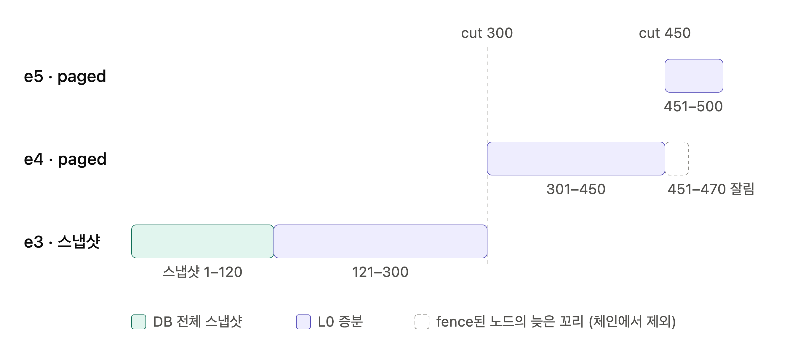
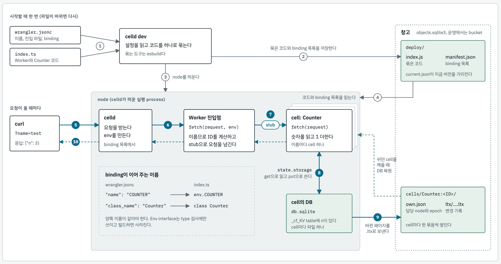

# 분산 시스템 설계(3) - 액터 모델(4): celld

지난 10월 9일 [Deno](https://deno.com/)의 개발자 Ryan Dahl은 [Deno의 개발팀이 Cloudflare에 합류한다](https://deno.com/blog/cloudflare)고 밝혔습니다. 그러면서 Deno는 향후 1년간 버그 픽스와 보안 업데이트를 제공하며, 그 이후에 Deno 개발을 완전히 중단한다고 합니다. 왜 그렇게 됐는지를 살펴보자면, 우선 Deno 개발을 왜 시작했었는지부터 이야기할 필요가 있습니다.

Ryan Dahl은 Node.js 개발 당시를 회상하면서 [자신이 후회하는 결정 10가지](https://www.youtube.com/watch?v=M3BM9TB-8yA)를 언급한 적이 있습니다. Promise 대신에 callback을 사용한 결정이나 시스템 접근에 제한이 없는 보안 이슈 등을 이야기 했죠. 만들고 나서야 보이는 것들이 많기 때문에 이런 후회는 계속할 수밖에 없긴 합니다만, Ryan Dahl은 그래서 Deno 개발을 시작했습니다.

그런데 개발 과정이 순탄치는 않았습니다. 사실상 Node.js가 표준이다 보니(현재 Node.js는 [OpenJS Foundation](https://openjsf.org/projects)에서 관리하는 프로젝트입니다!) Node.js와의 호환성도 계속 맞춰야 하는 문제가 있었죠. 그러다 보니 오히려 새로 등장한 [Bun](https://bun.com/)이 Node.js와의 호환성 및 속도를 앞세워 더 많은 사용자를 확보했습니다.

Node.js 호환 런타임 경쟁에서는 좀 어려움이 있었지만 Deno 팀의 목표가 단순히 런타임을 만드는 건 아니었다고 하는데요, 어플리케이션이 인프라의 복잡도와 상관없이 직관적으로 실행되고 운영될 수 있도록 만드는 게 목표였다고 합니다. 그래서 Deno Deploy 같은 서비스를 만들었지만 여전히 개발자가 신경써야 하는 복잡한 내용이 많다는 걸 느꼈고, 좀 더 단순하게 만들 수 있는 방법을 고민했다고 합니다.

액터 모델 시리즈를 계속 읽으신 분들이라면 느낌이 왔을까요? 지금까지 이야기한 내용과 뭔가 연결되는 게 있지 않나요? 일단 조금만 더 이야기 해보죠!

그래서 다다르게 된 결론이 [celld](https://celld.dev/)라고 소개하고 있습니다. celld는 Cloudflare Workers 프로그래밍 모델 기반으로, 개발자들이 분산 어플리케이션을 매우 쉽게 운영할 수 있도록 해준다고 합니다. 이미 Cloudflare에는 [Durable Objects](https://developers.cloudflare.com/durable-objects/)라는 서비스가 있는데요, celld는 그 Durable Objects를 Cloudflare가 아닌 자신의 인프라에서 운영할 수 있도록 해주는 런타임입니다.

네 그렇습니다! 바로 오늘 이야기할 celld가 js/ts 기반으로 액터 모델과 매우 유사한 형태로 분산 어플리케이션을 운영할 수 있게 해줍니다!

## celld의 구조

celld는 `플릿(fleet) -> 노드(celld instance) -> 셀` 의 구조로 구성됩니다. 앞서 살펴봤던 Orleans가 `클러스터 -> 사일로 -> 그레인`의 구조였던 것과 동일하죠!

<p align="center"><br/>https://celld.dev/</p>

각 서버 컴퓨터 별로 celld를 하나의 프로세스로 동작시키게 되는데, 이 프로세스가 노드입니다. 그리고 스토리지 버킷(bucket)을 공유하는 모든 노드의 집합을 플릿(fleet)이라고 부릅니다. 셀은 어떤 노드에서도 동작할 수 있기 때문에 노드만 플릿에 새로 추가하면 처리용량을 쉽게 늘릴 수 있습니다.

각 셀(Cloudflare의 Durable Object)은 고유한 id를 가진 서버 인스턴스로 자신만이 접근할 수 있는 SQLite 데이터베이스를 가지고 있습니다.  데이터베이스는 공유되지 않고 오로지 셀에서만 접근할 수 있기 때문에 자신만의 상태를 유지할 수 있습니다. 그리고 각 셀은 한 번에 하나의 스레드에서만 동작하기 때문에 동시성의 문제도 발생하지 않습니다.

셀의 생명주기 역시 Orleans의 그레인과 매우 유사합니다.

<p align="center"><br />https://developers.cloudflare.com/durable-objects/concepts/durable-object-lifecycle/</p>

- Active, in-memory(메모리에 존재): 셀이 메모리에서 들어오는 요청을 처리중
- Idle, in-memory(메모리에 존재) & non-hibernateable: 셀이 다음 요청을 기다리는 중이지만, hibernation은 불가한 상태
- Idle, in-memory상태(메모리에 존재) & hibernateable: 셀이 다음 요청을 기다리고 있으며, hibernation가능한 상태. 10초간 들어오는 요청이 없으면 Hibernated 상태로 진입한다.
- Hibernated: 셀이 메모리에서 제거되지만, 노드는 계속 셀의 소유권을 유지함. Hibernated 웹소켓 연결은 계속 연결된 상태로 유지된다.
- Inactive: 셀이 노드 프로세스에서 완전히 제거됨. 다음 요청을 받을 때 저장소에서 복원하는 cold-start를 해야 한다

> celld는 Hibernation까지의 시간을 CELLD_IDLE_EVICT_S로 설정합니다. 초 단위로 설정하며 기본값은 설정되어 있지 않습니다. 이 값이 설정되어 있지 않으면 메모리가 부족해지거나 노드의 셀 개수 상한에 도달할 때 셀이 메모리에서 제거되어 Inactive 상태가 됩니다. 셀 개수 상한은 CELLD_MAX_RESIDENT_CELLS로 설정하는데 기본값은 설정되어 있지 않기 때문에 별도의 설정이 없다면 메모리의 80%(CELLD_MAX_RSS_MB)가 상한이 됩니다.

Hibernation은 다음 조건을 만족할 때만 일어납니다.

- setTimeout/setInterval 으로 설정된 콜백이 없는 경우. Hibernation 이후에 콜백을 다시 생성할 방법이 없음.
- this.ctx.waitUntil()로 설정된 I/O 작업이나 promise가 없고, 응답을 전송할 외부 연결이 없는 경우.
- 표준 웹소켓 API를 사용하지 않은 경우
- 요청이나 이벤트를 처리 중이 아닌 경우

> celld에서 사용가능한 웹소켓은  표준 웹소켓 API와 celld 런타임에서 셀이 Hibernated 된 상태에서도 연결을 유지할 수 있도록 관리해주는 Hibernateable 웹소켓, 이렇게 2종류가 있습니다. 표준 웹소켓 API를 사용하면 셀이 Hibernated될 수 없으므로 가급적 Hibernateable 웹소켓을 사용해야 합니다.

## 셀의 소유권은 어떻게?

셀은 시스템 전체에서 고유한 액터이기 때문에 시스템 장애 상황을 제외하고는 딱 하나만 존재해야 합니다. 이미 특정 노드에서 활성화 시킨 셀을 다른 노드에서 다시 활성화 하려고 해서는 안 됩니다. 그러니까 각 노드별로 셀의 활성화 정보를 오차없이 기록하고 조회할 수 있는 방법이 필요한 거죠.

지난 글에서 다루었던 Orleans는 사일로간의 클러스터링을 위해서 Redis, ADO.NET, Azure Table Storage, AWS DynamoDB, ZooKeeper등의 다양한 방법을 지원했습니다. 그런데 celld는 조금 다른 전략을 선택합니다. celld는 각 노드간의 셀 소유권 정보를 스토리지 버킷으로 기록하고 제어하는데요, 버킷이 반드시 제공해야 하는 기능은 다음과 같습니다.

- 조건부 생성(conditional create): 객체가 이미 존재하는 경우 쓰기 요청은 반드시 실패해야 한다.
- 조건부 덮어쓰기(conditional overwrite): 객체를 읽어온 후 값을 변경해 쓰기 요청할 때, 읽은 이후에 객체가 변경되었다면 쓰기 요청은 반드시 실패해야 한다.
- 쓰기 성공 이후 읽기 일관성(read-after-write consistency): 쓰기 성공 후 객체를 읽으면, 반드시 쓰기 성공한 객체를 리턴해야 한다.
- 범위 읽기(ranged reads): 바이트 단위의 구간을 읽기 요청한 경우, 반드시 요청된 구간을 바이트 단위로 리턴해야 한다.
- 쓰기 성공 이후 목록 조회 일관성(list-after-write consistency): 쓰기 성공 후 객체 목록을 조회하면 반드시 쓰기 성공한 객체를 포함해야 한다.

> [공식 문서](https://celld.dev/docs/guarantees/#what-the-bucket-must-provide)에 따르면 2026년 11월 현재 위 조건을 만족하는 스토리지는 AWS S3, Cloudflare R2, Tigris, Google Cloud Storage, Azure Blob Storage 입니다.

그래서 celld는 노드가 시작될 때 4개의 조건부 쓰기 요청과 범위 읽기를 버킷에 보내서 앞서 알아본 요구사항을 만족하는지 응답을 체크합니다. 확인 결과 요구사항을 만족하지 못한 부분이 발견되면 노드는 그 즉시 실행을 중지합니다. `celld diagnose` 명령으로도 버킷을 체크해볼 수 있습니다.

## 셀 소유권 기록하기

노드가 셀을 소유하려면 버킷에 셀의 소유권을 기록해야 합니다. 소유권에는 소유자 노드 세션과 에포크(epoch)정보가 포함되는데요, 조건부 생성으로 버킷에 셀의 소유권을 기록합니다. `아직 아무도 버킷에 기록하지 않았을 때 쓰기 성공`으로 처리되기 때문에 셀의 소유권은 딱 1개의 노드만 가질 수 있습니다.

그리고 에포크를 통해서 만약의 경우에 발생할 수 있는 간섭을 방지합니다. 셀의 활성화, 다른 노드로 소유권 이전, 같은 노드에서 셀 다시 활성화 등의 작업이 일어날 때 항상 에포크가 증가하기 때문에 혹시라도 예전 에포크를 가지고 있는 셀이 쓰기 요청을 해도 막을 수 있도록 합니다.

## 에포크 기반 펜싱(fencing)

각 셀은 각자 자신만의 SQLite에 상태 정보를 저장합니다. 그런데 혹시라도 셀이 죽으면 다시 상태 데이터를 복구할 방법이 필요하겠죠? 그래서 각 노드는 자신의 프로세스에 복제기(replicator)를 실행해서 셀의 SQLite 데이터를 주기적으로 버킷에 복제합니다. 버킷의 경로가 `cells/<cell>/ltx/e<epoch>/`의 형태인데 이걸 에포크 접두사(epoch prefix)라고 부릅니다. 에포크에 따라 접두사가 달라지기 때문에 이미 뒤처진 에포크에 대한 요청으로부터 보호하는 펜스(fence) 역할을 하게 됩니다. 예를 들어서 다음과 같이 셀의 소유권이 바뀐 상황을 생각해보죠:

```
예시)
셀 X 점유 기록: { 소유자: A, epoch: 5 } -> B가 넘겨받음 -> { 소유자: B, epoch: 6 }
```

혹시라도 예전 셀이 살아남아서 계속 쓰기 요청을 보낸다고 해도 뒤처진 에포크 접두사에 데이터를 쓰게 됩니다. 그래서 활성 셀이 접근하는 에포크 접두사는 안전하게 유지될 수 있는데요, 이걸 펜싱(fencing)이라고 합니다.

> 에포크 접두사에서 볼 수 있는 ltx(Lite Transaction)는 SQLite에서 커밋된 트랜잭션을 묶음 파일로 만들 때 사용되는 포맷입니다.

## RPO=0?

celld의 소개 자료를 보면 `RPO=0`라는 말이 등장합니다. 이건 `Recovery Point Objective`의 약자로 `장애가 발생했을 때 유실되는 데이터`를 시간으로 나타낸 건데, 예를 들어서 1시간 마다 백업하면 RPO는 최대 1시간이 되는 겁니다. RPO=0 이라는 건 celld는 `장애가 발생해도 유실되는 데이터가 없다`는 말입니다. 그렇게 보장할 수 있는 이유는 celld가 다음과 같은 응답 확인 절차(output gate)을 거치기 때문입니다.

- 노드는 변경사항을 버킷에 업로드하고 쓰기 완료 응답을 받으면 클라이언트에게 응답한다. 즉, 버킷에 쓰기 완료되어 잃어버릴 여지가 없는 값을 클라이언트에게 응답한다.
- `CELLD_DURABILITY=fleet`(기본값) 으로 설정된 경우, 노드는 버킷에 업로드하는 동시에 같은 플릿에 위치한 다른 follower 노드(1~2개)에게 자신의 상태를 복제해줄 것을 요청한다. 복제 요청을 받은 노드는 자신의 디스크에 내용을 기록한 뒤 쓰기 완료(fsync)를 응답한다. 버킷과 follower 전체의 쓰기 완료 중 먼저 도착하는 응답으로 쓰기 완료를 확정하고 클라이언트에게 응답한다.
- `CELLD_DURABILITY=bucket` 으로 설정된 경우 버킷에 업로드하고 쓰기 완료 응답을 받는다.
- `CELLD_DURABILITY=fleet` 으로 설정되었더라도 플릿에 노드가 하나 뿐이라면 bucket 모드로 동작한다.

> 참고로 follower 노드 목록을 ensemble이라고 합니다.

즉, 클라이언트가 응답으로 받은 값은 서버 쪽에 장애가 발생해도 사라지지 않는다는 거죠!

클라이언트의 요청이 셀의 영속 스토리지 상태(SQLite)를 변경하는 경우 응답 확인의 대상이 됩니다.

- POST /cart/items: 장바구니에 상품을 INSERT
- POST /counter/increment: 카운터 값을 UPDATE
- GET /article/42인데 조회수 1 증가

그리고 읽기만 하는 요청이라도 대상이 될 수 있는데요, 예를 들면 이런 상황입니다.

1. 요청 A가 잔액을 100->50으로 변경. 로컬 SQLite에는 커밋했지만 아직 쓰기 확정 전
2. 요청 B가 잔액을 조회, 로컬 SQLite에서 읽어서 50을 리턴
3. B에 50을 응답하고, 장애 발생으로 노드가 종료됨
4. 셀이 복구되면 잔액은 아직 100

이렇게 되면 요청 B의 클라이언트는 존재하지도 않는 50을 응답으로 받은 셈이 되므로 쓰기 확정을 받기 전까진 응답을 하면 안 됩니다!

## 셀 복구 절차

구체적으로 어떻게 RPO=0을 달성한다는 건지는 복구 절차를 보면 좀 더 명확해 집니다. celld의 문서 자체가 워낙 스펙형태로 작성된 데다가 아는 사람만 아는 개념들을 많이 사용해서 좀 이해하기가 어려웠는데요, 예시로 제가 이해한 내용을 최대한 설명 해보겠습니다.

1. 플릿에 노드 A, B, C, D가 존재하고, cart라는 셀을 노드 A가 소유하고 있습니다. 버킷에 셀의 데이터(원래는 `cells/<cell>/ltx/e<epoch>/`의 형태지만 축약해서 `cart/e3`)는 txid 10까지 쓰기 완료된 상태입니다. 그리고 노드 간의 데이터 복제를 기록하는 node-log(`nodes/A.json` 파일 안에 `log` 항목)는 아직 생성되지 않은 상태입니다.

    |노드 A(소유자)|노드 B|노드 C|버킷|
    |--|--|--|--|
    |cart 소유(epoch 3)<br />로컬DB: txid 10까지|비어 있음|비어 있음|소유권: cart->A, epoch 3<br />cart/e3: txid ~10<br />nodes/A.json의 log: 없음|

2. 노드 A가 클라이언트에게 응답을 보내려면 다른 1-2개 노드에게 데이터를 복제하고 확정을 받아야 합니다. 그러려면 자신의 follower로 참여해주는 노드들을 한 묶음(ensemble)으로 설정하고 node-log를 사전에 생성해둬야 합니다. 그 결과는 다음과 같습니다.

    |노드 A(소유자)|노드 B|노드 C|버킷|
    |--|--|--|--|
    |cart 소유(epoch 3)<br />로컬DB: txid 10까지|비어 있음|비어 있음|소유권: cart->A, epoch 3<br />cart/e3: txid ~10<br />nodes/A.json의 log: Open<br />ensemble {B, C}, tiered 0|

3. 이제 클라이언트가 장바구니에 사과를 담았습니다. A가 자신의 로컬DB에 사과를 커밋하고 커밋된 데이터 f1을 B, C에 전송합니다. 두 노드가 모두 fsync로 쓰기 완료해줘야 A는 응답할 수 있습니다.

    |노드 A(소유자)|노드 B|노드 C|버킷|
    |--|--|--|--|
    |txid 11 사과->f1|f1 사과(fsync)|f1 사과(fsync)|소유권: cart->A, epoch 3<br />cart/e3: txid ~10<br />nodes/A.json의 log: Open<br />ensemble {B, C}, tiered 0|

4. 그리고 다음으로 클라이언트가 장바구니에 배를 담았습니다.

    |노드 A(소유자)|노드 B|노드 C|버킷|
    |--|--|--|--|
    |txid 11 사과->f1<br />txid 12 배->f2|f1 사과<br />f2 배|f1 사과<br />f2 배|소유권: cart->A, epoch 3<br />cart/e3: txid ~10<br />nodes/A.json의 log: Open<br />ensemble {B, C}, tiered 0|

5. 2초 마다 bundle 루프가 동작하면서 로컬에 커밋된 데이터를 버킷에 업로드합니다. A가 txid 11, 12를 버킷(node bundle)에 업로드했고, B, C는 업로드가 완료된 데이터를 지울 수 있습니다.

    |노드 A(소유자)|노드 B|노드 C|버킷|
    |--|--|--|--|
    |txid 11, 12 업로드 됨|(f1, f2 정리됨)|(f1, f2 정리됨)|소유권: cart->A, epoch 3<br />cart/e3: txid ~10<br />node bundle: f1, f2<br />nodes/A.json의 log: Open, tiered 2|

6. 귤, 포도를 장바구니에 담았습니다. 귤은 f3로 전송되어 B, C 모두 fsync해서 응답했지만, 아직 f4는 B만 fsync한 상태입니다.

    |노드 A(소유자)|노드 B|노드 C|버킷|
    |--|--|--|--|
    |txid 13 귤 -> f3(응답완료)<br />txid 14 포도->f4(미응답)|f3 귤(fsync)<br />f4 포도(fsync)|f3 귤(fsync)|소유권: cart->A, epoch 3<br />cart/e3: txid ~10<br />node bundle: f1, f2<br />nodes/A.json의 log: Open, tiered 2|

7. 갑자기 노드 A에 장애가 발생해서 프로세스가 종료되었습니다. 귤은 클라이언트가 응답을 받았지만 B, C만 가지고 있고 버킷에는 기록되지 못한 상황입니다.

    |노드 A(소유자)|노드 B|노드 C|버킷|
    |--|--|--|--|
    |프로세스 종료|f3 귤(fsync)<br />f4 포도(fsync)|f3 귤(fsync)|소유권: cart->A, epoch 3<br />cart/e3: txid ~10<br />node bundle: f1, f2<br />nodes/A.json의 log: Open, tiered 2|

    > 만약 노드 A는 계속 동작하지만 메모리 부족 등의 문제로 셀의 소유권을 포기하면, 복구를 위한 recovery gate가 동작하지 않습니다. 셀의 소유권을 넘겨받는 D가 follower들의 데이터를 cart/e3로 모으는 작업이 진행됩니다.

8. cart 요청을 노드 D가 받으면서 cart 셀의 에포크를 증가시키고 자신의 소유로 가져갑니다. 버킷에서 복원하려고 node-log를 보니 Open 상태입니다. 지금 복원하면 txid 12 까지만 있어서 이미 클라이언트에게 응답한 귤이 사라집니다. 복구를 해야 하는 상황인 거죠.

    |노드 A(소유자)|노드 B|노드 C|버킷|
    |--|--|--|--|
    |프로세스 종료|f3 귤(fsync)<br />f4 포도(fsync)|f3 귤(fsync)|소유권: cart->D, epoch 4<br />cart/e3: txid ~10<br />node bundle: f1, f2<br />nodes/A.json의 log: Open -> 복구필요|

9. D가 nodes/A.json의 log 상태를 `Open->Recovering` 으로 조건부 덮어쓰기(CAS) 합니다. 만약 A가 잠시 네트워크가 끊어진 상태에서 다시 돌아왔다고 해도, 이제는 로그를 갱신하려는 CAS가 모두 실패하게 됩니다.

    |노드 A(소유자)|노드 B|노드 C|버킷|
    |--|--|--|--|
    |프로세스 종료|f3 귤(fsync)<br />f4 포도(fsync)|f3 귤(fsync)|소유권: cart->D, epoch 4<br />cart/e3: txid ~10<br />node bundle: f1, f2<br />nodes/A.json의 log: Recovering (D)|

10. D가 B, C의 디스크 복제를 차단(seal) 합니다. 이제 B, C는 A가 추가 복제 요청을 보내더라도 거부합니다.

    |노드 A(소유자)|노드 B|노드 C|버킷|
    |--|--|--|--|
    |프로세스 종료|f3 귤(fsync)<br />f4 포도(fsync)<br />sealed|f3 귤(fsync)<br />sealed|소유권: cart->D, epoch 4<br />cart/e3: txid ~10<br />node bundle: f1, f2<br />nodes/A.json의 log: Recovering (D)|

11. 연결된 모든 follower 노드로부터 데이터를 모아서 f4까지 확정하고, bundle의 f1, f2와 함께 f3, f4를 셀의 에포크 접두사에 올립니다.

    |노드 A(소유자)|노드 B|노드 C|버킷|
    |--|--|--|--|
    |프로세스 종료|sealed, 끝=f4|sealed, 끝=f3|소유권: cart->D, epoch 4<br />cart/e3: txid ~14<br />(사과, 배, 귤, 포도)<br />node bundle: (f1, f2-> cart/e3로 이동)<br />nodes/A.json의 log: Recovering (D)|

    > 클라이언트에게 이미 응답한 귤(f3)의 경우 B, C로부터 모두 fsync를 받은 상태입니다. follower 중에서 C만 응답하게 된다면 포도(f4)가 사라지게 되지만, 아직 응답을 하지 않은 상태라서 RPO=0의 약속을 어기는 건 아닙니다!

12. D가 nodes/A.json의 log 상태를 Sealed로 CAS합니다. 이제 A가 응답한 데이터가 모두 버킷에 저장된 걸 보증할 수 있습니다. 그리고 이제 복원을 진행할 준비가 끝났죠!

    |노드 A(소유자)|노드 B|노드 C|버킷|
    |--|--|--|--|
    |프로세스 종료|sealed, 끝=f4|sealed, 끝=f3|소유권: cart->D, epoch 4<br />cart/e3: txid ~14<br />nodes/A.json의 log: Sealed|

13. 이제 D가 cart/e3에서 셀 데이터를 복원했습니다. 이제 cart 셀의 데이터는 cart/e4로 저장됩니다.

    |노드 A(소유자)|노드 B|노드 C|버킷|
    |--|--|--|--|
    |프로세스 종료|sealed, 끝=f4|sealed, 끝=f3|소유권: cart->D, epoch 4<br />cart/e3: txid ~14<br />cart/e4: txid 14 까지의 스냅샷으로 시작<br />nodes/A.json의 log: Sealed|

    참고로 D가 cart/e4의 데이터를 복원하는 과정은 다음과 같습니다.
    1. 에포크 접두사 목록을 받아서 각 에포크의 객체 txid 범위를 확인한다.
    2. e4가 비어있으니, 가장 최신 e3를 확인한다.
    3. e3에서 txid 1을 찾는다
    4. e3가 txid 1로 시작하므로 전체 데이터를 다 확인할 수 있다. 검색 종료.
    5. e3의 데이터 스냅샷을 e4에 업로드해서 복원.

    물론 이건 e3에 txid 1부터 시작하는 데이터가 다 있을 때의 이야기 인데요, 그렇지 않을 때는 대략 이렇습니다.
    <p align="center"></p>

    1. e5가 txid 451에서 시작하니까 스냅샷이 아닙니다. 이제 450에서 끝나는 이전 에포크를 찾습니다.
    2. e4에서 451이상을 잘라내고, 첫 txid가 301이니까 계속 아래로 탐색합니다.
    3. e3를 301 미만으로 잘라내고 txid 1을 찾았기 때문에 스냅샷으로 판단하고 멈춥니다.
    4. 결과는 e3(1-300) + e4(301-450) + e5(451-500)이 됩니다!

## 카운터 샘플

celld의 깃허브 리포를 확인해보면 다양한 샘플이 있습니다. 물론 문서가 대단히 불친절했던 것처럼 샘플 역시 대단히 불친절합니다. 일단 그 중에 가장 간단한 [카운터 샘플](https://github.com/denoland/celld/tree/main/examples/counter)을 확인해보겠습니다.

이후 작업에서는 Javascript를 그대로 사용하기 보다는 Typescript를 사용할 건데요, 우선 tsconfig.json을 정의합니다.

```json
{
  "compilerOptions": {
    "target": "es2022",
    "module": "esnext",
    "moduleResolution": "bundler",
    "lib": ["es2022"],
    "types": ["@cloudflare/workers-types"],
    "strict": true,
    "noEmit": true,
    "isolatedModules": true,
    "verbatimModuleSyntax": true,
    "noUncheckedIndexedAccess": true,
    "skipLibCheck": true,
    "forceConsistentCasingInFileNames": true
  },
  "include": ["index.ts"]
}
```

다음으로 package.json을 선언하고 패키지를 설치합니다.

```json
{
  "scripts": {
    "typecheck": "tsc -p tsconfig.json",
    "dev": "celld dev . --port 9877"
  },
  "devDependencies": {
    "@cloudflare/workers-types": "^5.20261104.1",
    "esbuild": "^0.28.2",
    "typescript": "^7.0.2"
  }
}
```

이어서 wrangler.jsonc에는 celld가 실행할 셀의 클래스와 호출 경로 이름 등을 명시합니다.

```json
{
  "name": "counter",
  "main": "index.ts",
  "compatibility_date": "2026-01-01",
  "durable_objects": {
    "bindings": [{ "name": "COUNTER", "class_name": "Counter" }]
  },
  "migrations": [{ "tag": "v1", "new_sqlite_classes": ["Counter"] }]
}
```

[wrangler](https://developers.cloudflare.com/workers/wrangler/)는 Cloudflare의 개발자 플랫폼을 위한 CLI 도구이며, Worker 프로젝트를 관리하는 데 사용됩니다. celld는 Cloudflare의 Worker 프로그래밍 모델을 기반으로 하기 때문에 동일한 wrangler를 사용합니다. 설정 파일의 속성들은 다음과 같은 의미입니다.

- name: Worker의 이름. 알파벳과 숫자(alphanumeric), 그리고 대시(-)만 포함할 수 있습니다.
- main: Worker의 진입점이 될 파일.
- compatibility_date: 코드를 실행하기 위해 사용할 Worker 런타임 버전. 전체 버전 히스토리는 [공식 문서](https://developers.cloudflare.com/workers/configuration/compatibility-flags/#flags-history)에서 확인할 수 있습니다.
- durable_objects: Worker가 바인딩되어야 할 Durable Objects 목록
- migrations: Durable Object의 클래스 이름과 런타임 상태간의 매핑 정보

설정 파일에 대한 전체 내용은 [공식 문서](https://developers.cloudflare.com/workers/wrangler/configuration/)를 통해 확인할 수 있습니다.

그리고 샘플 리포의 index.js를 Typescript로 변환한 코드입니다.

```ts
/**
 * celld가 들어오는 요청과 함께 전달해주는 객체의 인터페이스 정의(타입을 명시하기 위해서만 사용됨)
 * 실제 값은 wrangler.jsonc에 정의된 durable_objects.bindings 에서 생성됨.
 */
interface Env {
  /**
   * DurableObjectNamespace는 셀(DurableObject) 클래스의 인스턴스 집합.
   * 새 셀(DurableObject)의 참조를 생성하거나 이미 존재하는 셀(DurableObject)의 참조를 가져오는데 사용된다.
   * 
   * 이 이름은 wrangler.jsonc의 durable_objects.bindings.name에 해당한다.
   */
  COUNTER: DurableObjectNamespace;
}

/**
 * 요청의 ?name= 파라미터로 전달받은 이름에 대해서 1개씩 생성되는 카운터 셀(DurableObject) 클래스
 * 
 * 클래스 이름은 wrangler.jsonc의 durable_objects.bindings.class_name에 해당한다.
 */
export class Counter implements DurableObject {
  /** 
   * celld가 셀에 넘겨준 상태 객체.
   */
  private readonly state: DurableObjectState;

  // celld가 셀을 깨울 때 한 번 호출한다.
  constructor(state: DurableObjectState, _env: Env) {
    this.state = state;
  }

  /** 
   * 셀로 요청이 들어올 때 마다 실행된다.
   */
  async fetch(request: Request): Promise<Response> {
    let n = (await this.state.storage.get<number>("n")) ?? 0;
    n++;
    // 셀의 sqlite에 저장
    await this.state.storage.put("n", n);
    return Response.json({ n, url: request.url });
  }
}

// 코드 실행의 진입점. ?name= 값으로 카운터를 골라 요청을 그대로 넘긴다.
export default {
  /**
   * HTTP 요청이 들어오면 호출된다.
   * @param request 들어온 요청
   * @param env 앞서 정의한 Env. wrangler.jsonc에 정의된 COUNTER의 binding이 들어있다.
   * @returns 셀의 응답을 그대로 리턴
   */
  async fetch(request: Request, env: Env): Promise<Response> {
    // ?name= 쿼리에서 이름을 추출
    const name = new URL(request.url).searchParams.get("name") ?? "default";
    // 추출한 이름으로 셀 id 계산(같은 값에 대해 항상 같은 id 생성)
    const id = env.COUNTER.idFromName(name);
    // 셀의 id와 연결되는 stub(원격 호출을 전달하는 대리 객체)을 얻고, 셀의 fetch를 호출.
    // 셀은 실제로 fetch가 호출될 때 생성되거나 깨어난다.
    return env.COUNTER.get(id).fetch(request);
  },
} satisfies ExportedHandler<Env>; // 이 객체가 코드 실행의 진입점으로 사용할 수 있는지 타입 체크
```

이 코드를 보고, 원문의 코드를 다시 보시면 얼마나 설명이 허접하게 되어있는지 알 수 있습니다! celld가 Cloudflare의 DurableObjects에 이미 익숙하다는 가정을 하고 있기 때문에 이런 문제가 발생하는 거긴 하지만 그래도 좀... 이건 아니지 않나 싶긴 합니다!

### 샘플 코드의 실행 구조

<p align="center"></p>

1. `celld dev`로 서버를 실행하면, wrangler.jsonc를 통해 진입점이 되는 파일과 binding 목록을 확인합니다. 그리고 esbuild가 index.ts를 실행에 필요한 js파일로 번들링 합니다.
2. 스토리지 버킷(로컬에서는 .celld/dev/objects.sqlite3)에 번들링된 js파일과 binding 목록을 기록합니다.
3. celld가 노드 프로세스를 실행합니다. 파일의 변경을 지켜보고(watch) 있기 때문에 파일이 변경될 때마다 1, 2번을 다시 실행합니다. 다시 빌드하는 동안에는 기존 코드가 계속 응답합니다.
4. 노드 프로세스가 버킷에서 코드와 binding 목록을 읽어와서 셀 코드를 실행할 준비를 합니다.
5. HTTP 요청이 노드 프로세스에 도착합니다.
6. celld가 env(binding 목록을 포함)와 들어온 요청을 Worker의 진입점으로 설정된 fetch에 전달합니다.
7. Worker가 셀 id로 stub(원격 호출을 셀에 전달해줄 대리 객체)을 얻어 셀의 fetch를 호출합니다. 이때 celld가 요청을 처리할 셀을 생성하거나 깨웁니다. 비활성화 되었던 셀이라면 버킷에서 상태를 복원합니다.
8. 셀이 자신의 상태(state.storage, 셀의 SQLite)를 확인하고 1을 더해서 저장합니다.
9. celld가 업데이트된 SQLite 데이터를 .ltx 파일로 만들어 버킷에 업로드합니다.
10. 노드 프로세스가 1개 이므로 버킷에 업로드가 완료되면 응답을 리턴합니다.

앞서 좀 복잡하게 살펴봤던 내용이 실제로 이렇게 동작하게 됩니다. 원래는 스토리지 버킷에 각 셀의 상태가 저장되어야 하지만, 로컬 개발 환경에서는 SQLite가 그 역할을 대신합니다. 그리고 fleet 모드라고 하더라도 노드 프로세스가 1개이기 때문에 모든 요청은 버킷에 업로드 완료되어야만 클라이언트에게 응답합니다.

### 코드를 실행해보자!

우선 celld를 설치해야겠죠?

```bash
> curl -fsSL https://celld.dev/install.sh | sh
> celld version
...
celld 0.6.3
```

그리고 celld 서버를 실행합니다.

```bash
> npm run dev         

> dev
> celld dev . --port 9877

<jemalloc>: option background_thread currently supports pthread only
celld dev
  Project  /Users/onlifecoding/src/celld/counter/wrangler.jsonc
  State    /Users/onlifecoding/src/celld/counter/.celld/dev
  Logs     hidden (use --logs)
  ● opening the local storage
  ● building the application
<jemalloc>: option background_thread currently supports pthread only
  ready  http://127.0.0.1:9877
```

그리고 다른 터미널에서 다음과 같이 테스트를 진행합니다.

```bash
~/src/celld/counter
❯ curl "http://127.0.0.1:9877/?name=test"
{"n":1,"url":"http://127.0.0.1:9877/?name=test"}
~/src/celld/counter
❯ curl "http://127.0.0.1:9877/?name=test"
{"n":2,"url":"http://127.0.0.1:9877/?name=test"}
~/src/celld/counter
❯ curl "http://127.0.0.1:9877/?name=test2"
{"n":1,"url":"http://127.0.0.1:9877/?name=test2"}
~/src/celld/counter
❯ curl "http://127.0.0.1:9877/?name=test" 
{"n":3,"url":"http://127.0.0.1:9877/?name=test"}
~/src/celld/counter
```

각 name별로 카운터 셀이 생성되었고, 각 셀 별로 값이 잘 증가하고 있습니다.

이렇게 테스트를 실행하고 폴더를 확인해보면 `.celld` 폴더가 하나 생긴 걸 확인할 수 있는데요, 폴더의 구조는 대략 다음과 같습니다.

```
.celld/dev/
├── objects.sqlite3                     # 스토리지 버킷(로컬에서는 sqlite로 대체)
└── runtime/
    └── Counter:<64자리 ID>/             # 셀 하나
        └── ltx/
            └── e<epoch>/
                ├── db.sqlite           # 셀의 DB
                ├── db.sqlite-wal       # SQLite가 변경을 먼저 적어 두는 파일
                ├── db.sqlite-shm
                └── .db.sqlite-litestream/ltx/0/<순번>-<순번>.ltx    # ltx 트랜잭션 파일
```

앞서 전체 구조를 살펴보면서 확인했던 objects.sqlite3 파일이나 각 셀 별로 상태 값을 버킷에 업로드하는 내용을 확인할 수 있죠. objects.sqlite3의 테이블 스키마를 확인해보면 다음과 같습니다.

```bash
❯ sqlite3 objects.sqlite3
SQLite version 3.54.0 2026-04-09 12:25:13
Enter ".help" for usage hints.
SQLite-3.54 objectsCopy.sqlite3-> .schema
CREATE TABLE objects (
                   key TEXT PRIMARY KEY,
                   body BLOB NOT NULL,
                   etag INTEGER NOT NULL,
                   modified_ms INTEGER NOT NULL,
                   attributes TEXT NOT NULL
                 );
CREATE TABLE store_sequence (
                   singleton INTEGER PRIMARY KEY CHECK (singleton = 1),
                   next_etag INTEGER NOT NULL
                 );
```

각 테이블과 컬럼은 이런 정보를 저장합니다.

| table | column | 설명 |
|---|---|---|
| `objects` | `key` | 파일 경로처럼 생긴 이름. `/`가 들어간 긴 이름 하나이고 실제 폴더는 없다. |
| | `body` | 내용 전체 |
| | `etag` | 저장할 때마다 오르는 번호. 덮어써도 새 번호를 받는다. |
| | `modified_ms` | 마지막으로 저장한 시각 |
| | `attributes` | 덧붙인 정보. `.ltx`에는 기록한 시각이 들어 있다. |
| `store_sequence` | `next_etag` | 다음에 줄 `etag` 번호 |

그리고 objects 테이블의 내용을 쿼리해보면 다음과 같습니다.

```bash
SQLite-3.54 objectsCopy.sqlite3-> SELECT key, length(body), etag FROM objects ORDER BY key;
╭────────────────────────────────────────────┬────────────┬────╮
│                    key                     │length(body)│etag│
╞════════════════════════════════════════════╪════════════╪════╡
│cells/Counter:0a097959fb54376c392cd3312b4047│        2341│  69│
│4e3d31d73163ba94ba8fe50a464826118e/ltx/e1/  │            │    │
│0000/0000000000000001-0000000000000001.ltx  │            │    │
├────────────────────────────────────────────┼────────────┼────┤
│cells/Counter:0a097959fb54376c392cd3312b4047│         276│  74│
│4e3d31d73163ba94ba8fe50a464826118e/ltx/e1/  │            │    │
│0000/0000000000000002-0000000000000002.ltx  │            │    │
├────────────────────────────────────────────┼────────────┼────┤
...
├────────────────────────────────────────────┼────────────┼────┤
│deploy/counter/3f691dbb702a0b50/index.js    │         837│ 352│
├────────────────────────────────────────────┼────────────┼────┤
│deploy/counter/3f691dbb702a0b50/manifest.   │         676│ 353│
│json                                        │            │    │
├────────────────────────────────────────────┼────────────┼────┤
│deploy/counter/bf5806589892a6cc/index.js    │         827│ 149│
├────────────────────────────────────────────┼────────────┼────┤
│deploy/counter/bf5806589892a6cc/manifest.   │         676│ 150│
│json                                        │            │    │
├────────────────────────────────────────────┼────────────┼────┤
│deploy/counter/current.json                 │         149│ 354│
├────────────────────────────────────────────┼────────────┼────┤
│deploy/current.json                         │         149│ 355│
├────────────────────────────────────────────┼────────────┼────┤
│fleet/capacity-v1.json                      │         763│ 617│
├────────────────────────────────────────────┼────────────┼────┤
│fleet/peer-auth.json                        │          86│  14│
├────────────────────────────────────────────┼────────────┼────┤
│nodes/dev-326478f023c6.json                 │         713│ 621│
├────────────────────────────────────────────┼────────────┼────┤
│wake/format.json                            │          12│   6│
├────────────────────────────────────────────┼────────────┼────┤
│wake/waker.json                             │          54│ 618│
╰────────────────────────────────────────────┴────────────┴────╯
```

좀 복잡해 보이지만 `key`를 통해서 파일을 구분해볼 수 있는데요, 대략 다음과 같습니다.

| key | 담긴 것 |
|---|---|
| `cells/Counter:<ID>/own.json` | 이 셀을 맡은 노드와 epoch |
| `cells/Counter:<ID>/ltx/e<N>/0000/*.ltx` | 셀의 변경 기록 |
| `deploy/counter/<버전>/index.js` | esbuild로 묶은 코드 |
| `deploy/counter/<버전>/manifest.json` | class 목록, binding, module 목록 |
| `deploy/current.json`, `deploy/counter/current.json` | 지금 쓰는 버전을 가리킨다 |
| `nodes/<node>.json` | 노드가 살아 있다는 표시. 기본 10초 동안 유효하고 계속 갱신한다. node-log도 이 파일의 `log` 항목에 들어 있다. |
| `fleet/capacity-v1.json` | 노드들의 부하 정보 |
| `fleet/peer-auth.json` | 노드끼리 서로를 확인하는 비밀 key |
| `wake/waker.json` | alarm을 깨우는 역할을 누가 맡았는지 |
| `wake/format.json` | alarm 기록 형식의 버전 |

## 정리하며

역시 정리하는 게 쉽지 않네요. 아무리 AI가 자료 조사를 도와주고, 코드를 분석해줘도 celld의 문서 자체가 너무 암호같은데다가 Durable Objects 자체도 처음 볼때는 간단해 보이지만 파면 팔수록 너무 복잡하네요. 나중에 이 내용을 다시 봤을 때 제가 이해할 수 있을지를 생각하면서 최대한 직관적으로 정리하려고 애써봤는데요, 좀 쉽지 않았던 거 같습니다. 좀 더 정리하고 싶은 내용도 있었지만, 일단은 여기서 끊어야겠네요!

그동안 액터 모델에 대해서 여러가지 조사하고 정리해보면서 새로 배우게 된 내용과 새로운 시각에서 기존 기술들을 볼 수 있어서 너무 즐거웠습니다. 이제 또 다른 흥미거리를 찾아서 정리해봐야겠죠!

## 참고 자료

- [Deno is joining Cloudflare](https://deno.com/blog/cloudflare)
- [10 Things I Regret About Node.js - Ryan Dahl](https://www.youtube.com/watch?v=M3BM9TB-8yA)
- [celld](https://celld.dev/)
- [celld 문서](https://celld.dev/docs/)
- [What celld guarantees](https://celld.dev/docs/guarantees/)
- [denoland/celld (GitHub)](https://github.com/denoland/celld)
- [celld 샘플: counter](https://github.com/denoland/celld/tree/main/examples/counter)
- [Cloudflare Durable Objects](https://developers.cloudflare.com/durable-objects/)
- [Lifecycle of a Durable Object](https://developers.cloudflare.com/durable-objects/concepts/durable-object-lifecycle/)
- [Use WebSockets (Durable Objects)](https://developers.cloudflare.com/durable-objects/best-practices/websockets/)
- [Durable Objects: Easy, Fast, Correct — Choose three](https://blog.cloudflare.com/durable-objects-easy-fast-correct-choose-three/)
- [Wrangler](https://developers.cloudflare.com/workers/wrangler/)
- [Wrangler Configuration](https://developers.cloudflare.com/workers/wrangler/configuration/)
- [Compatibility flags](https://developers.cloudflare.com/workers/configuration/compatibility-flags/)